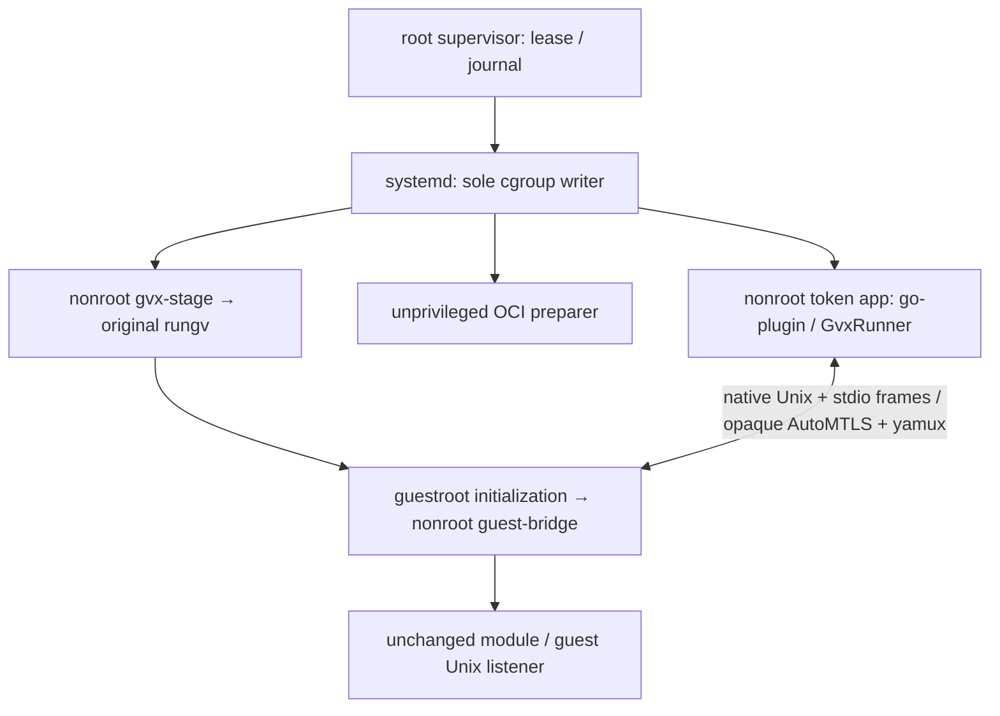

# gvx 기반 자체 포함 런타임 - Spec Proposal

| Item       | Detail                           |
|------------|----------------------------------|
| Author     | Seonguk Moon                     |
| Created    | 2026-11-16                       |
| Status     | **Draft** / In Review / Approved |
| Reviewers  |                                  |

---

## 1. Summary

Chatanium 배포 실행 파일에 원본 `rungv` 바이너리를 포함하고, 별도 Docker나 엔진 데몬 설치 없이 초기화와 실행을 제공합니다. Chatanium은 정적 host-stage와 guest-bridge, 기존 특권 supervisor를 통해 OS 자원, 이미지 준비, 모듈 전송과 수명을 관리하며 기존 모듈 바이너리와 `core-v2`, AutoMTLS 프로토콜은 변경하지 않습니다. 포그라운드와 선택적 systemd 서비스에 같은 승인, 강제, 종료 및 복구 계약을 적용하고 중지, 프로그램 제거와 데이터 파기를 구분합니다.

## 2. Background & Motivation

gvx 채택과 원본 바이너리 내장은 확정된 방향입니다. 기존 private containerd, shim, `runsc`, `gvisor-bin`, CNI 제안을 대체합니다. 외부 엔진 설치를 없애되 단순한 `rungv run` 호출이 기존 승인, 소켓 신뢰, quota와 회수 계약을 충족한다고 보지는 않습니다.

소스 확인 시점은 `2026-11-16T11:33:39Z`입니다. 당시 최신 main은 `a9bfd06c2c07a16e76972ff43379e0ebe0d4223a`, 릴리스 표기는 `v0.16.10002026110900`입니다. 아래 사실은 실행 검증이나 호환성 인증 결과가 아닙니다.

| 확인 대상 | 실제 기능과 제한 | 필요한 제품 glue |
|-----------|------------------|--------------------|
| `rungv run` | `gvx.New`와 `Run`을 연속 호출합니다. 독립된 Create/Start/Wait/Kill API는 없습니다. | 실행 전 gate와 stdio 연결을 제공합니다. |
| 실행 설정 | systrap, none/NAT, 명시적 사용자, read-only root, hostfs bind와 stdio를 지원합니다. | 승인된 고정 argv를 생성합니다. |
| OCI metadata | 런타임 config와 `inspect`는 Labels를 보존하지 않습니다. | exact OCI config에서 선언을 검증합니다. |
| 이미지/cache | `load`, digest cache 조회를 지원합니다. archive 실행과 default-cache import는 별도 경로입니다. cache는 record/layer/sidecar가 같은 디렉터리에 있습니다. | 단일 이미지 archive를 사전 load하고 전체 immutable cache를 read-only로 공유합니다. |
| Linux go-plugin | Unix listener를 생성합니다. MIN/MAX_PORT로 Linux TCP를 강제할 수 없습니다. | guest Unix와 native host Unix를 stdio로 연결합니다. |
| gvx forwarding | 대상은 guest `10.0.2.15`이며 none과 함께 사용할 수 없습니다. | IPC에 port publication을 사용하지 않습니다. |
| go-plugin multiplex | 하나의 yamux 연결로 역방향 broker까지 처리합니다. | 추가 multiplexer 없이 bytes만 운반합니다. |
| hostfs | `.gvx_meta`가 없으면 native mode의 guest 0:0입니다. mount UID remap은 없고 workspace open에도 쓰기가 발생합니다. | trusted guest bootstrap으로 root 속성을 초기화하며 metadata를 보존합니다. |
| 자원 제한 | CLI 설정은 외부 강제의 대체가 아니며 guest PID hard limit 플래그는 없습니다. | systemd host cgroup과 guest PID 의미를 구분합니다. |
| Chatanium | Platform, SQLite journal, peer/pidfd 인증, grant, XFS reclaim과 manifest 일치 검사가 있습니다. | 계약을 유지하며 Docker 구현을 교체합니다. |

## 3. Goals & Non-Goals

### 3.1 Goals

- [ ] 검증된 실행 파일의 수동 진단, 보호된 설치, 안내형 초기화와 포그라운드 실행을 연결합니다.
- [ ] 원본 `rungv`와 제품 소유 glue의 책임을 분리하고 필요한 사용자 공간 의존성을 배포물에 포함합니다.
- [ ] 기존 모듈 바이너리, protobuf, AutoMTLS, broker guard와 opaque credential 의미를 유지합니다.
- [ ] 비실행 이미지 검사부터 실행 중 인증된 manifest까지 변경 불가능한 이미지 식별을 유지합니다.
- [ ] systemd 단일 cgroup writer, 실제 XFS quota, 독립된 outer netns와 철회 가능한 egress를 적용합니다.
- [ ] 불확실한 생성과 정리 결과를 영속화하고, 확인하지 못한 자원을 재사용하거나 성공 처리하지 않습니다.
- [ ] 기존 공개 명령, 개발 호출자와 운영 문서를 새 기본 실행 경로로 함께 전환합니다.

### 3.2 Non-Goals

- [ ] gvx SDK를 앱에 링크하거나 upstream fork, 자체 gVisor 내부, EROFS 구현, ext4 드라이버를 개발하지 않습니다.
- [ ] 별도 엔진 데몬, Docker 런타임, private containerd, CNI framework와 복수 기본 backend를 유지하지 않습니다.
- [ ] rootless, ARM64, 네이티브 macOS/Windows, 다른 서비스 관리자와 checkpoint/restore는 포함하지 않습니다.
- [ ] OS 패키지 자동 설치, 전역 sysctl 수정, LSM 해제, 다른 제품 방화벽이나 Docker 설정 변경을 하지 않습니다.
- [ ] 구 Docker 데이터 자동 채택, 실행 중 엔진 교체나 이전 epoch 재접속을 제공하지 않습니다.
- [ ] 모듈 프로토콜 재설계, 별도 테스트 프로젝트, 광범위한 매트릭스와 벤치마크는 포함하지 않습니다.

## 4. Technical Design

### 4.1 Architecture Overview

이 절 이후는 새 구현의 목표 계약입니다. 제안 파일과 API는 기존 기능이 아닙니다. 원본 gvx 내장이 사용자 결정이고 아래 glue는 이를 구현하기 위한 설계입니다.



| 역할 | 책임과 권한 |
|------|-------------|
| 기존 root supervisor | lease, journal, 현재 grant 재검증, unit/mount/quota/netns/firewall과 native listener 생성/회수를 소유합니다. 별도 controller daemon을 만들지 않습니다. |
| token app | 전용 runtime UID와 bot token을 사용합니다. 비특권 `GvxRunner`가 listener accept, frame parsing과 로그 분리를 담당합니다. |
| preparer | 별도 비특권 서비스에서 획득, archive/layer 검사, 압축 해제와 EROFS 준비를 수행합니다. 작업별 registry credential만 받습니다. |
| sandbox host identity | app과 다른 고정 UID/GID로 stage/rungv를 실행합니다. 데이터 재사용 동안 유지하며 capability, net-admin과 cgroup 쓰기 권한을 받지 않습니다. |
| guest identity | INIT의 승인 nonzero UID/GID를 최종 bridge/모듈에 적용합니다. 초기 trusted bridge만 virtual root이며 host UID/socket owner와 구분합니다. |
| systemd | cgroup의 유일한 writer이며 app, stage, preparer와 외부 helper를 각각 서비스로 직접 시작합니다. |

첫 지원은 Linux/amd64, EL9 native ABI, systemd 252 이상 지정 기능과 cgroup v2입니다. namespace, seccomp, pidfd, openat2, controller, XFS/loop/mount와 LSM 권한을 확인합니다. systrap을 명시하며 KVM은 필수가 아닙니다. Landlock의 실제 ABI/권한과 배포 CPU baseline도 확인합니다. 커널 `5.14`만으로 지원을 추정하거나 검토 릴리스의 amd64-v2 요구를 무시하지 않습니다. 부족한 전제는 제한 하향 없이 거부합니다.

foreground scope에는 관리자 하나만 둡니다. PID1에 등록하고 active/member 상태를 확인한 뒤 하위 서비스를 시작합니다. 설치형 manager는 자체 service를 owner로 사용합니다. 모든 하위 서비스는 정확한 owner에 `BindsTo`와 `After`를 설정합니다. owner scope에서 helper를 fork한 뒤 이동하지 않습니다. 남은 helper가 scope를 유지하는 crash window를 없애며 별도 guardian을 두지 않습니다. owner 결박은 즉시 egress 철회나 cleanup 증거는 아닙니다.

특권 API는 현재 epoch, live pidfd, 설치 소유권과 기존 grant를 재검증합니다. 임의 host path, OCI spec, shell, hook, flag와 firewall expression을 받지 않습니다. root는 신뢰 경계 안에 있습니다. launcher는 `.env`, 호출자 PATH/loader/proxy/`GVX_DEBUG_LOG`를 상속하지 않습니다. 기존 `secret_sources`의 명시적 `env:NAME`만 worker에 전달하고 bot secret을 preparer, stage, rungv, bridge나 journal에 넣지 않습니다.

| 현재 파일 또는 신규 경로 | 구현 책임 |
|--------------------------|-----------|
| `internal/host/contracts.go`, `state.go`, `supervisor_linux.go` | Platform, 인증, claim과 불확실성 의미를 유지하고 Docker 식별을 unit/instance로 교체합니다. |
| 신규 `internal/host/gvx_platform_linux.go`, `systemd_linux.go`, `gvx_stage_linux.go` | `GvxPlatform`, unit 제출/관측, gate, 자원 변환과 결과 수집입니다. `docker_platform.go`를 대체합니다. |
| 신규 `cmd/gvx-stage/`, `cmd/gvx-guest-bridge/`, `internal/gvxipc/` | 제품 static launcher/guest bootstrap, frame codec입니다. 원본 rungv와 별도 artifact입니다. |
| 신규 `internal/host/gvx_runner.go`, `gvx_output.go` | Docker runner/output을 대체하며 FD 수명, handshake 전용 pipe, native endpoint를 담당합니다. |
| 신규 `internal/host/gvx_image.go`, `internal/provision/` | Docker image 조회를 대체하며 OCI record, canonical archive, preparer와 publication을 담당합니다. |
| 신규 `internal/host/gvx_network_linux.go` | 기존 network 정책을 이관하고 bridge/IPAM/DOCKER-USER를 owned netns/veth/hook으로 교체합니다. |
| `storage_linux.go`, `storage_persistent_linux.go`, `quota_linux.go` | 실제 quota/reclaim을 유지하고 host/guest identity, native IPC, 로그와 metadata 회계를 분리합니다. |
| `client_linux.go`, `control_linux.go`, `internal/runtime/{manager,reload,manifest,config}.go` | SCM_RIGHTS 및 immutable image 입력을 이관하고 AutoMTLS, broker guard와 manifest 동등성을 유지합니다. |
| 신규 `internal/bootstrap/`, `cmd/`, `internal/app/` | init, owner 실행, stop/service/removal을 연결하고 외부 supervisor 운영 요구를 통합합니다. |
| `tools/host/prepare.py`, `tools/build/images.py`, `tools/dev/`, `Makefile`, 운영 문서 | 준비 로직을 Go로 이관하고 실행 호출자를 일괄 전환합니다. label 생성과 빌드 전용 Docker는 유지할 수 있습니다. |
| `shared/core-v2/plugin.go`, `shared/discord-v2`, `proto/`, 기존 모듈 | 바이너리와 wire contract를 유지하며 bridge 때문에 이미지를 재빌드하지 않습니다. |

신규 경로는 소유 범위 제안입니다. obsolete runtime 파일, 설정, alias와 주석은 호출자 이관과 함께 제거하며 호환 shim을 남기지 않습니다.

| 제품 경로 | 소유권과 보존 |
|-----------|---------------|
| `/usr/local/bin/chatanium` | verified root launcher이며 상위 경로도 일반 사용자가 교체할 수 없어야 합니다. |
| `/etc/chatanium/runtime.json`, `secrets/` | 구성과 제한된 worker secret입니다. |
| `/var/lib/chatanium/installation.json`, `control/` | 설치 식별/ledger/SQLite이며 workload 고갈 영역 밖에 둡니다. |
| `/var/lib/chatanium/storage/data.xfs` | 사전 할당한 유한한 제품 일반 파일입니다. |
| XFS의 `images/`, `prepared/`, `persistent/`, `instances/` | 원본 OCI, immutable cache, hostfs, scratch/IPC별 회계를 적용합니다. |
| `/var/lib/chatanium/engines/<bundle_digest>/` | 변경 불가능한 전체 bundle이며 sandbox에 필요한 read/traverse/execute만 허용합니다. |
| `/run/chatanium/<runtime_installation_id>/` | control/stage/netns handle이며 단독 복구 근거로 사용하지 않습니다. |

### 4.2 Data Model Changes

기존 SQLite FULL/WAL journal과 strict JSON을 확장합니다. 로컬 format marker/schema는 모듈 `core-v2`와 기존 설정 버전과 별개입니다. 릴리스가 지원하는 형식만 읽으며 없는 버전이나 구 Docker 상태를 추측해 해석하지 않습니다.

| 레코드 | 필수 저장 정보 |
|--------|----------------|
| 설치 manifest | `runtime_installation_id`, gvx 형식/schema, 설치 및 desired 실행 상태, active/pending revision, 경로 소유권, app/sandbox/preparer UID/GID, bundle, backing file 식별/XFS UUID, 크기와 예산을 저장합니다. |
| provisioning ledger | 변경 전 intent, 대상 종류/식별, 원래 존재/제품 생성 여부, desired/observed/cleanup을 저장합니다. |
| 기존 `installations` | 모듈 installation ID, storage key/project를 보존하고 guest UID/GID와 stable host owner, image/config/approval 참조를 분리합니다. |
| `ImageRecord` | source 종류/ref/archive digest, 원본 index/manifest bytes/digest, selected linux/amd64 manifest exact bytes/digest, config exact bytes/digest, ordered layer descriptor/diffID, 선언 bytes/digest, canonical archive digest, execution ref와 revision을 저장합니다. |
| cache generation | engine bundle, archive/manifest 연결, 파생 파일 및 sidecar integrity, publication 상태, live/recovery reference를 저장합니다. |
| epoch/instance | 기존 epoch, instance, claim과 retired ID를 확장하여 제품/모듈/epoch/instance, 승인, 최초 실패와 정리 결과를 연결합니다. |
| unit observation | 고유 unit/generation, boot/job/InvocationID, cgroup, MainPID/starttime, executable digest와 resource fingerprint를 저장합니다. pidfd는 live handle이며 FD 숫자를 복원하지 않습니다. |
| network/quota | 고정 family profile, netns/veth 식별, 예약 prefix와 양 끝 주소/route, uplink/source, filter/NAT generation, conntrack, project와 reclaim 관측을 저장합니다. |
| native endpoint | trusted directory와 socket dev/inode/owner/mode, instance/runtime identity, FD 전달/종료 상태를 저장합니다. guest path는 별도 비신뢰 입력입니다. |
| guest root intent | root ID/host identity/고정 guest mountpoint, new/pending/retained 구분, 허용한 초기/단계별/완료 속성, nonce/digest와 durable confirmation을 저장합니다. retained mismatch는 복구 오류입니다. |

이미지/cache/provisioning/unit 레코드는 별도 테이블로 추가하고 instance가 안정된 식별로 참조합니다. `create_submissions`의 Docker kind와 `ContainerID`는 service/network 및 unit identity로 이관합니다. 제품 `runtime_installation_id`와 기존 모듈 `installation_id`를 합치지 않습니다. 구 Docker 데이터가 연결된 대상은 명시적 오프라인 이관 없이 거부하지만, 독립 경로의 신규 설치는 실제 충돌이 없으면 무관한 Docker와 공존합니다.

설치 상태는 `PROVISIONING`, `READY`, `RECOVERY_REQUIRED`입니다. READY는 준비와 임시 정리 완료이며 실행 상태가 아닙니다. desired `STOPPED`는 manager 재시작 후에도 admission을 금지하고 복구만 허용합니다. 명시적 start가 이를 새 실행 intent로 전환합니다. backing image/known persistent directory 유실이나 식별 불일치는 복구 오류이며 생성 또는 mkfs로 보충하지 않습니다.

| instance 상태 | 의미 |
|---------------|------|
| `PREPARING` | 자원을 예약하고 quota/cache/닫힌 topology를 준비합니다. |
| `CREATED` | stage identity, 강제와 연결된 stdio를 확인했지만 rungv는 gate 뒤에 있습니다. |
| `STARTING` | 일회성 START intent 이후 bridge/bootstrap 중이며 권한은 닫혀 있습니다. |
| `READY` | handshake, AutoMTLS, 인증된 manifest 일치, 승인/강제를 확인하고 승인 범위만 활성화했습니다. |
| `STOPPING` | admission/권한/egress를 닫고 unit/전송을 종료합니다. |
| `CLEANUP_PENDING` | 생성 또는 부재/회수가 불확실하여 claim/세대 참조와 재사용 금지를 유지합니다. |
| `STOPPED` | job/process 부재, 전송 종료와 임시 회수를 증명했습니다. persistent는 남깁니다. |

생성의 `SUBMITTED/OBSERVED/REJECTED`는 별도 축입니다. 완료된 authoritative negative만 REJECTED로 바꾸며 timeout, D-Bus 단절, 단일 NotFound는 SUBMITTED를 유지합니다. 미해결 claim도 admission에 포함하고 unit/instance 이름을 재사용하지 않습니다. 최초 실패 원인과 후속 cleanup 오류를 함께 보존합니다.

### 4.3 Core Logic

#### 설치, 진단과 초기화

실행 전 별도로 신뢰한 릴리스 검증 수단으로 다운로드 출처를 확인합니다. 미검증 바이너리의 자기 검증이나 같은 출처 checksum만으로 신뢰를 시작하지 않습니다.

```sh
./chatanium doctor
sudo install -o root -g root -m 0755 ./chatanium /usr/local/bin/chatanium
sudo chatanium init
sudo chatanium start --foreground
```

`doctor`는 root여도 passive read만 수행하며 추출, unit/probe 생성이나 강제 시험을 하지 않습니다. 권한 부족은 `needs_privileged_check`로 표시합니다. init/start는 승인한 소유 객체 준비 후 실제 강제를 확인하고 그 전에는 모듈을 활성화하지 않습니다.

init은 계정 DB 변경, 디렉터리, 비밀, XFS 크기, bundle, 다운로드와 임시 preparer 계획을 먼저 승인받습니다. app/sandbox/preparer 계정을 구분하고 기존 사용자 전용이나 Docker 그룹 편입은 하지 않습니다.

1. 유지보수 lease와 대상 소유권을 확인하고 첫 PROVISIONING을 control 경로에 commit합니다. 실패하면 후속 자원을 만들지 않습니다.
2. 단계별 intent 후 승인 객체만 준비합니다. 최초 제품 일반 파일만 사전 할당/포맷하며 host block device, fstab이나 기존 파일시스템은 변경하지 않습니다.
3. 제한된 preparer에서 아래 이미지 절차를 수행하되 모듈은 실행하지 않습니다. 검사한 digest/선언/config/요청 상한을 표시한 뒤 모듈 승인을 별도로 받습니다. `allResources`도 자동 승인하지 않습니다.
4. pending revision을 저장하고 preparer/helper, writer 및 데이터 handle을 모두 닫은 뒤 owned mount/loop를 해제합니다.
5. 준비와 임시 정리를 증명한 뒤 revision/READY를 원자 활성화합니다. 실패는 ledger에 남기며 전 단계 원자 rollback을 약속하지 않습니다.

재실행은 pending부터 조정합니다. 정지된 READY 설정 갱신은 ID/owner/데이터를 유지합니다. 취소나 config 오류만 있으면 이전 active revision을 보존하고 cleanup도 불명확하면 복구 상태를 남깁니다. init은 영구 서비스를 등록하지 않습니다.

#### 변경 불가능한 이미지 준비와 실행 연결

획득, archive/layer parsing, 압축 해제와 EROFS compilation은 CPU/memory/time/byte/inode가 제한된 비특권 preparer에서 수행합니다. root controller는 PID1의 격리와 실제 native 증거를 검증하고, 승인된 bounded metadata의 digest/label 재검증 및 publication을 담당합니다. OCI client는 `github.com/google/go-containerregistry`를 추가하고 기존 `image-spec v1.1.1`, `go-digest v1.0.0`을 재사용합니다. registry credential은 해당 작업에만 전달하며 사용자 `~/.docker`나 임의 credential helper를 읽지 않습니다.

준비 서비스는 `PrivateUsers=true`로 만든 root-owned private USER namespace를 사용하며 controller의 host USER namespace 바로 아래에 있어야 합니다. Preparer UID와 primary GID만 사용하고 capabilities는 없으며 NoNewPrivileges를 유지합니다. root는 namespace owner/parent, 정확한 UID/GID map, setgroups deny, pidfd/PID/start/invocation과 모든 task의 권한을 실제로 확인합니다. mount namespace와 승인된 storage bind identity도 별도로 검증합니다. systemd 252의 속성 이름이나 커널 버전만으로 지원을 인정하지 않으며, 필요한 kernel/systemd/root 경계가 없으면 target 작업 전에 거부합니다. 제품 실행에 Docker daemon은 필요하지 않고 build-time Docker만 별개로 사용합니다.

준비 전용 gate는 domain 1/protocol 2/filter 2입니다. dispatch 전 immutable launch에 filter 2를 결박하고, READY의 native birth를 저장한 뒤 ARM을 보냅니다. FILTER_READY에서는 stage의 실제 고정 BPF digest와 모든 thread의 TSYNC 전이를 재검증합니다. full evidence와 START intent를 같은 transaction에 저장한 뒤에만 START로 target 데이터 작업을 허용합니다. 이 필터는 sendmsg/sendmmsg뿐 아니라 recvmsg/recvmmsg도 거부해 외부 seccomp listener를 받아 writable FD를 주입하는 경로를 닫고, io_uring 세 syscall과 foreign ABI/x32도 거부합니다. 일반 stream/file I/O, HTTP/TLS, pure-Go DNS와 poller는 유지합니다. ioctl 번호 하나만 막는 우회가 아니며 `rungv run`, worker/module IPC나 CGO 변형에 이 준비 필터를 적용한다는 뜻도 아닙니다.

source/work pool은 root:root `0700`, prepared pool은 root:RuntimeGID `0710`을 유지합니다. `prepared/<job>` envelope는 birth부터 root:root `0700`이고, 그 안에 직접 만든 Preparer `0700`의 `generation`만 `/chatanium/cache`에 writable bind합니다. pool이나 envelope를 RW로 노출하지 않으며 pending 디렉터리나 rename은 없습니다. 기존 durable path/JobID는 그대로이고 두 cache 디렉터리 모두 같은 project와 기존 inode hard limit에 포함합니다. 봉인 후 module generation은 root:SandboxGID `0550`, development-worker generation은 root:RuntimeGID `0550`을 사용합니다.

1. 획득 tag를 한 번 resolve하고 exact index/manifest digest와 descriptor size를 검증합니다. linux/amd64 concrete manifest를 정확히 하나 선택합니다. 깊이/count/JSON/압축 및 해제 bytes를 제한하고 모호한 platform, 미지원 schema/media, foreign layer와 config 불일치를 거부합니다.
2. exact config의 `org.chatanium.flexmodule.manifest.v2`를 기존 strict protobuf-JSON으로 검증합니다. ordered layer descriptor와 diffID를 확인하고 원본 config/manifest를 재직렬화하지 않습니다.
3. 온라인/오프라인 모두 `oci-layout`, 단일 concrete descriptor의 `index.json`, exact manifest/config/layer blobs로 canonical OCI tar를 만듭니다. annotation은 `io.containerd.image.name=chatanium.invalid/module-cache:sha256-<selectedManifestHex>`입니다. cache namespace이며 승인 근거가 아닙니다.
4. gate를 통과한 원본 바이너리에 generation-only private cache alias를 전달합니다.

```text
rungv load --arch=amd64 --cache-dir=/chatanium/cache --input=CANONICAL_ARCHIVE
```

5. immutable writer 증거와 실제 unit/process/task/private-namespace 해소를 확인한 뒤 generation을 제자리에서 root-owned readonly로 봉인합니다. Work를 제거하고 실제 project usage zero를 입증한 다음, 정확한 envelope exposure intent를 저널링하고 root:RuntimeGID `0710`으로 동기화하여 공개한 뒤 Committed를 기록합니다. FD/proc 관측은 보조 증거이며 원래 획득의 writer-domain proof를 대신하지 않습니다. opaque envelope handle도 실제 회수를 막을 수 있으므로 무시해서 quota-zero를 만들지 않습니다.
6. `ImageManifest`는 준비 완료 레코드의 label bytes만 반환합니다. inspect나 모듈 실행으로 선언을 얻지 않습니다. 승인은 source/selected manifest/config/declaration/실행 정책과 revision에 결박합니다.

원본 OCI는 권위 있는 content store이고 EROFS는 파생 데이터입니다. EROFS checksum과 compressed blob digest는 같지 않습니다. 검증 archive, 고정 compiler와 immutable publication이 변환 연결을 제공합니다. record/layer/sidecar 전체를 instance별 private mountpoint에 read-only 공유하고 매 실행 복사/재컴파일하지 않습니다. writable metadata root, named ext4lite volume과 cache 내부 volume은 없습니다. live/recovery reference가 있으면 GC하지 않습니다.

실행 참조와 옵션은 레코드에서만 생성합니다.

```text
--cache-dir=READONLY_INSTANCE_VIEW
--registry-url=https://chatanium.invalid
--pull=never
chatanium.invalid/module-cache@sha256:<SELECTED_MANIFEST_HEX>
```

명시적 registry override로 PullNever에도 가능한 default-cache import를 차단하며 해당 경로는 네트워크를 사용하지 않습니다. host CWD는 owned empty directory로 고정해 archive shadowing을 막습니다. 사용자 실행 경로, `rungv run ARCHIVE`, `--bin`, raw layers, tag fallback과 실행 중 fetch는 금지합니다.

오프라인은 bounded OCI-layout/Docker-save tar만 받습니다. arbitrary extraction 없이 absolute/traversal/NUL, normalized-name 중복, link/device, unknown entry와 overflow를 거부합니다. OCI exact blobs를 보존합니다. Docker-save는 archive digest, exact config/diffID 검증 후 승인 전에 canonical OCI manifest를 만들고 원본 archive와 derived digest를 구분합니다. derived 값을 registry digest로 표시하지 않으며 plain rootfs tar는 거부합니다.

#### 기존 준비 이력의 격리와 staged bundle 전환

현재 준비의 readiness/reuse에는 원래 획득의 immutable domain/protocol/filter 증거가 필요합니다. readonly mode나 hash, 나중의 load 결과로 COMPLETE 이력을 보완하지 않습니다. filter 1을 포함한 미지원 이력은 정확히 완전한 구 형식 증거가 유효한 경우 cleanup-only로 읽을 수 있을 뿐, 현재 dispatch/no-START/readiness 권한으로 승격하지 않습니다. 원래 writer 증거가 없거나 미지원인 legacy 획득과 파생 cache도 committed lineage와 outer/internal helper COMPLETE 이력이 확인된 경우에만 명시적으로 quarantine합니다. pending/uncertain native 작업을 완료 이력으로 바꾸지는 않습니다. 기록, claims와 retention-only revision/management reference는 유지하지만 launch/candidate/readiness, source rebuild/reuse와 development 사용은 거부합니다. full disposal의 실제 ownership/reference 및 quota-zero 조건은 완화하지 않습니다.

설치된 A가 현재 준비 프로토콜을 지원하지 않으면 별도로 인증하고 보호한 B launcher에서 기존 `prepare-image --installation-id ID --operator`를 사용합니다. 정확한 계획은 기존 `--operator --plan PATH`로 선택합니다. 승인에는 PreparationBundleDigest, QuarantineSetDigest, ExpectedActiveRevision과 교체할 기존 image record가 미리 결박되어야 하며 fresh job/source/credential/limits와 실제 새 receipt를 사용합니다. B helper를 비활성 상태로 공개해 준비할 수 있지만 설치 bundle, active/pending revision, launch 권한이나 RECOVERY_REQUIRED 상태는 바꾸지 않습니다. backing/project/app 검증과 관련 없는 미완료 native 복구도 우회하지 않습니다.

준비의 실제 cleanup/detach가 끝나면 호환되는 검증 launcher의 `stop --installation-id ID`로 일반 복구를 명시 요청하고, 그다음 B의 `update --installation-id ID`에서 전체 candidate를 별도로 검토하고 승인합니다. active binding에 quarantined image가 남아 있으면 start는 여전히 거부합니다. Update는 모든 의도한 module을 보존하고, 사전 승인된 module/old-image/preparation-plan ID 및 digest와 B의 정확한 fresh image/cache receipt를 선택합니다. 일치 결과가 없거나 모호하면 거부하고, 기존 `update --plan PATH`도 선택된 참조를 그대로 재검증합니다. selector/latest/order로 추측하거나 A의 Configure, 임시 module 제거, cache relabeling 또는 legacy/missing-cache rebuild로 우회하지 않습니다.

backup, pending revision, config/launcher replacement와 B activation은 그 명시 승인된 Update에서만 수행합니다. 재실행도 원래 승인과 선택 receipt 및 허용된 phase 전이를 사용하며 활성화 이후의 현재 상태로 새 대상을 고르지 않습니다. 기존 grant/resource/path/secret 및 native cleanup 조건은 그대로입니다. isolated-child 결과를 privileged runtime이나 최종 native release 검증 성공으로 간주하지 않으며, 해당 실행 수용 검증은 아직 남아 있습니다.

#### systemd 생성, gate와 시작

관리자만 설치 lease를 보유하며 FD를 상속하지 않습니다. start는 설치/bundle/host/storage를 검증하고 이전 미완료 자원을 조정한 뒤 새 epoch와 app 서비스를 시작합니다. live owner가 있으면 중복 실행을 거부합니다.

1. 현재 grant/image/revision/자원을 검증하고 instance/generation/unit/project/topology intent를 commit합니다. unit은 설치/epoch/instance/generation으로 결정하고 재사용하지 않습니다. 이름이나 nonce만으로 인증하지 않습니다.
2. quota, readonly cache, trusted bridge bind, native listener와 닫힌 outer netns를 준비합니다. stdin/out/err pipe와 SUBMITTED를 기록한 뒤 `StartTransientUnit(mode=fail)`으로 static stage를 실행합니다. shell은 없습니다.
3. D-Bus Unix-FD passing의 `StandardInputFileDescriptor`, `StandardOutputFileDescriptor`, `StandardErrorFileDescriptor`로 세 stdio를 연결합니다. v252에 확인한 속성만 사용하며 추가 FD 상속을 가정하지 않습니다.
4. PID1이 UID/GID, cgroup, netns와 mount 제한을 적용한 뒤 stage를 실행합니다. stage가 root로 시작해 뒤늦게 격리하지 않습니다. 설정은 root 소유이며 지정 sandbox가 읽을 수 있는 readonly 경로입니다.
5. stage는 guest에 노출하지 않은 private Unix에서 bounded READY를 보냅니다. root는 SO_PEERCRED/pidfd/boot/starttime와 D-Bus InvocationID/MainPID/cgroup, executable 및 namespace를 대조합니다. 자기 신고한 InvocationID를 신뢰하지 않습니다.
6. `cpu.max`, `memory.max`, `memory.swap.max`, `pids.max`와 mount/network identity를 확인하고 OBSERVED/CREATED를 commit합니다. 다섯 FD를 인증 runtime에 전달합니다. rungv는 아직 gate 뒤에 있습니다.
7. Start는 현재 lease/deny를 재검증하고 STARTING을 commit한 뒤 일회성 START를 보냅니다. stage는 control FD를 CLOEXEC로 닫고 동일 PID에서 원본 rungv를 exec합니다. gate timeout/EOF/잘못된 명령이면 실행하지 않습니다.

| unit 속성 | 계약 |
|-----------|------|
| 수명 | `Type=exec`, `Restart=no`, `KillMode=control-group`, `SendSIGKILL=yes`, `AddRef=true`, `CollectMode=inactive-or-failed`, 유한한 `TimeoutStopUSec`, owner `BindsTo/After`입니다. job 성공은 module ready가 아닙니다. |
| 자원 | 유한한 `MemoryMax`, `MemorySwapMax=0`, `TasksMax`, `CPUQuotaPerSecUSec/CPUQuotaPeriodUSec`, `Delegate=no`입니다. systemd만 cgroup을 씁니다. |
| 권한/마운트 | 비특권 User/Group, zero capabilities, no-new-privileges입니다. 빈 `SupplementaryGroups`는 추가 그룹만 비우며 NSS 그룹을 제거하지 않습니다. 전용 계정에 예상 밖 그룹이 없어야 하고 실제 모든 thread의 그룹 집합이 primary GID 이상의 권한을 갖지 않는지 확인합니다. private view에는 해당 실행 closure/cache/lease와 stage socket만 두고 secrets/control DB/다른 instance를 제외합니다. |
| 네트워크 | PID1이 소유 `NetworkNamespacePath`로 시작합니다. systrap/Landlock과 모든 제한을 함께 만족하지 못하면 지원 profile을 거부합니다. |

CPU 변환은 `CPUQuotaPerSecUSec=NanoCPUs/1000`, kernel quota는 `NanoCPUs*periodUSec/1e9`입니다. overflow/최소 단위/정확한 표현을 확인하고 ceiling 상향 반올림을 거부합니다. memory/task도 effective 값이 승인과 일치해야 합니다. 기존 `max_pids`는 host task/thread 상한이며 guest PID 수 보장이 아닙니다. 가상 `--pids-limit`는 없습니다. MemoryMax는 rungv/bridge/guest 전체 비용입니다.

고정 argv는 `--platform=systrap --arch=amd64 --lockdown=true --privileged=false --net-raw=false --allow-packet-socket-write=false --allow-suid=false --read-only=true --user=0:0`입니다. guestroot는 trusted static bridge 초기화에만 사용하며 host UID는 항상 비특권입니다. 승인 hostfs와 readonly bridge 디렉터리를 bind하고 entrypoint를 `/run/chatanium-bootstrap/guest-bridge`, command를 `--stdio-v1`로 지정합니다. tty/detach/publish/checkpoint socket은 없습니다. 원래 Entrypoint+Cmd 또는 승인 override는 INIT에만 넣으며 blob/digest를 바꾸지 않습니다.

bridge bootstrap은 고정 workdir/minimal env를 사용합니다. rungv에 clear-env가 없고 mergeEnv가 base 중복을 보존하므로 image env의 duplicate/invalid name, NUL과 과대한 값을 거부합니다. 모든 비승인 image key에 `--env=KEY=`를 생성한 뒤 고정 PATH/HOME/TMPDIR 등을 지정합니다. image loader/hook/shell/module은 초기화 전에 실행하지 않습니다. 원래 승인 child env/workdir는 INIT으로만 전달하며 host stage env도 별도 allowlist입니다.

D-Bus 단절은 admission을 닫습니다. Subscribe/JobRemoved, GetUnit/ListUnits와 기록 job으로 관측하고 unit 결과/reference를 journal까지 보존합니다. timeout/drop/NotFound 뒤 재제출하지 않습니다. 지연 job/stage 불능의 authoritative 근거 또는 boot fence 없이 claim을 풀지 않습니다. manager 재시작은 old epoch를 폐기하고 조정하며 lost pipe에 재접속하거나 모듈을 adopt하지 않습니다.

#### 모듈 IPC와 원본 프로토콜 보존

root가 scratch-accounted native IPC dir에서 listener를 생성하고 socket pathname을 O_PATH로 고정합니다. guest에는 마운트하지 않습니다. host owner/group/mode는 runtime 정책이며 guest UID가 아닙니다. GvxRunner에 stdio 3개, listener FD와 socket-path O_PATH FD를 전달합니다. root는 별도 O_PATH를 유지합니다. runner는 등록 runtime의 PID/pidfd/lease와 SO_PEERCRED가 일치하는 연결 하나만 허용하며 reconnect는 없습니다.

raw rungv stdout은 frame 전용이며 `Runner.Stdout`은 handshake 한 줄용 pipe입니다. `Runner.Start`는 gate 해제와 pump 시작 후 반환하고 handshake 소비를 기다리지 않습니다. handshake writer는 검증한 한 줄 전달 직후 또는 시작 실패 시 닫습니다. stage는 stdout을 쓰지 않습니다. 이후 module stdout과 module/bridge/rungv stderr는 bounded diagnostics로 보내며 producer 종료 시 diagnostics writer도 닫습니다.

양방향 시작 magic은 ASCII `CTGVXIPC1` 9 bytes입니다. header는 `type:u8`, reserved 3 bytes=0, length:uint32 big-endian의 8 bytes입니다.

| type | 방향/payload와 순서 |
|------|--------------------|
| `1 INIT` | H→G, strict JSON, magic 후 한 번입니다. |
| `9 ROOTS_READY` | G→H, bounded root-manifest digest/nonce/step results입니다. INIT 후 trusted 초기화만 수행한 상태입니다. |
| `10 ROOTS_COMMIT` | H→G, payload 없이 해당 연결의 INIT nonce에 결박된 일회성 승인입니다. manager의 durable 확인 뒤에만 보냅니다. |
| `2 HANDSHAKE` | G→H, ROOTS_COMMIT/권한 하향/자식 시작 뒤 원본 LF-terminated line 한 번입니다. |
| `3 OPEN`, `4 OPEN_OK` | H→G/G→H, 길이 0입니다. native client accept 후 고정 guest socket 연결을 확인하며 목적지 필드는 없습니다. |
| `5 DATA` | 양방향, 최대 16 KiB입니다. OPEN_OK 이후 해당 FIN 전의 yamux bytes입니다. |
| `6 FIN` | 양방향 각 한 번, 길이 0이며 해당 write half만 닫습니다. |
| `7 EXIT` | G→H, child 시작 이후 한 번이며 `{kind:exit|signal,value:integer}`입니다. exit는 0..255, signal은 1..64입니다. 해당 방향의 terminal frame이며 unit 결과를 대체하지 않습니다. |
| `8 ERROR` | 양방향 bounded code/message이며 terminal로 양쪽을 닫고 unit을 중지합니다. |

INIT 필드는 argv/env/workdir/uid/gid/socket_dir/roots이며 5절 타입과 일치합니다. 첫 argv는 절대 실행 경로, env는 중복 없는 key=value 배열, UID/GID는 최종 nonzero identity입니다. control frame 최대는 `min(ControlMessageMaxBytes,60 KiB)`이며 empty frame은 0, DATA는 16 KiB입니다. header/state/direction/length를 할당 전에 검사합니다. unknown type, reserved!=0, duplicate INIT/ROOTS_COMMIT/OPEN, unknown/duplicate JSON key, trailing JSON, NUL과 잘못된 순서는 fatal입니다.

ERROR code는 INVALID_INIT/INVALID_HANDSHAKE/INVALID_FRAME/OPEN_FAILED/STARTUP_TIMEOUT/IO_FAILED/CHILD_FAILED로 한정합니다. root 초기화 오류는 INVALID_INIT입니다. 고정 DATA buffer와 backpressure를 사용하고 별도 queue/multiplexer는 없습니다. control/scanner, 양방향 DATA buffer와 log slab의 총 상주량이 LogBufferBytes에 맞지 않으면 시작을 거부합니다.

INIT에는 승인 image env와 기존 bootstrap만 합칩니다. mandatory PLUGIN key와 충돌한 image env는 거부합니다. `FLEXMODULE_PLUGIN=CHATANIUM_FOREVER`, `PLUGIN_PROTOCOL_VERSIONS=2`, `PLUGIN_MULTIPLEX_GRPC=true`를 요구합니다. `PLUGIN_CLIENT_CERT` exact PEM은 multiline JSON으로 전달하며 argv/env-file에 넣지 않습니다. `PLUGIN_UNIX_SOCKET_DIR`는 scratch-backed `/tmp`의 새 guest-private dir이고 GROUP은 guest primary GID의 숫자 문자열입니다. MIN/MAX_PORT를 TCP 전환 수단으로 해석하지 않으며 host secrets/paths는 없습니다.

hostfs는 virtual metadata가 없으면 native mode를 유지한 guest 0:0을 반환합니다. 따라서 host sandboxUID의 0700 root를 moduleUID가 쓸 수 있다고 가정하지 않습니다. 다음 trusted bootstrap을 사용합니다.

```text
INIT (controller-authored finite root manifest, never module-supplied):
  verify exact no-symlink directory FDs and controller-known root intents
  new/pending root: accept only expected pre-step/known-step/completed attrs
                    guest fchown/fchmod root only, never recursive; sync and read back
  retained root: verify expected virtual attrs only; mismatch => stop, never repair
  send ROOTS_READY(digest, nonce, bounded step results)
Runner -> authenticated ConfirmGuestStorage:
  manager checks lease, pending intent and its own host identities; fsyncs result
  runner sends ROOTS_COMMIT only after authorization; timeout/disconnect => no module
Bridge after COMMIT:
  clear supplementary groups, capability bounding/ambient sets
  set real/effective/saved GID and UID to approved nonzero values; clear remaining caps
  set no_new_privs; verify credentials/caps for all threads; close initialization FDs
  launch unchanged module directly; child stdin=/dev/null; bridge alone owns rungv stdin
```

초기화 manifest는 controller 고정 root ID/guest mountpoint/속성/intent만 포함합니다. root manager는 보고에서 host path나 새 작업 권한을 받지 않습니다. 보고는 pinned bootstrap의 관측이며 승인 자체가 아닙니다. interruption은 같은 durable intent의 알려진 단계만 재개합니다. native owner/mode를 완화하거나 `.gvx_meta`를 직접 작성하지 않습니다. metadata 없는 populated legacy tree는 별도 승인 import 없이는 지원하지 않습니다. static Go bridge는 process-wide/all-thread credential syscall을 사용하며 thread-local setter로 대체하지 않습니다. 실패하면 종료합니다. 이후 bridge도 nonroot이며 module 출력/socket 처리는 하향 후에만 시작합니다.

첫 module line은 `1|2|unix|PATH|grpc|CERT|true`로 검증합니다. PATH는 지정 socketdir의 canonical direct child이고 traversal/symlink/type/owner/group/mode 불일치를 거부합니다. guest가 confined O_PATH로 inode를 잡아 `/proc/self/fd/N`으로만 dial합니다. host는 bounds/exact path를 재검증하되 guest inode 진술을 host 인증으로 쓰지 않습니다.

PluginToHost는 unix+exact handshake path만 받고 `/proc/self/fd/<runner-local-O_PATH-FD>`로 변환합니다. manager-local 번호나 listener의 `socket:[inode]` FD를 쓰지 않습니다. HostToPlugin은 전부 거부합니다. mandatory yamux의 reverse Core/FileTransfer/Discord와 AutoMTLS를 그대로 운반하며 bridge는 TLS/권한/RPC를 해석하지 않습니다.

gate/root-init/handshake/open은 StartupDeadline의 남은 시간을 공유하며 control 작업에는 host-operation deadline도 적용합니다. bridge는 child 종료 뒤 bounded drain과 EXIT 전송을 마치고 보통 종료코드 0..255를 그대로 반환합니다. guest signal s는 128+s로 반환하고 EXIT에 원래 signal을 남깁니다. 이는 host `kind=exit`이며 host signal/OOM 증거가 아닙니다. bootstrap/전송 실패는 비영(125) 종료이며 성공으로 바꾸지 않습니다. EXIT 뒤 완전한 frame 경계의 EOF는 정상 완료 후보이고, 조기 EOF/잘린 frame/timeout은 실패입니다. Runner.Wait는 별도로 실제 unit 결과와 host OOM 증거를 확인하며 missing 결과는 UNKNOWN입니다.
EXIT 수신 뒤 새 DATA 송신을 중단합니다. 정상 완료와 경합한 pipe EOF/EPIPE는 정리 결과로 분류하되 기존 프로토콜 오류는 지우지 않습니다. handshake/manifest 완료 전 child 종료는 exit 0이어도 시작 실패입니다.

종료 시 accept를 중단하고 deadline으로 대기를 깨우며 accepted connection과 pump 입출력을 먼저 닫거나 취소합니다. handshake/diagnostics writer를 닫아 go-plugin reader를 종료시킨 뒤 client startup/Kill/multiplex와 pump를 join합니다. in-flight dial에 필요한 listener/path pin은 이때까지 보존하고 마지막에 닫습니다. 그 뒤에만 scratch를 회수합니다. graceful 완료와 실패 모두 이 순서를 따릅니다.

#### 저장소와 전체 예산

hostfs persistent/scratch에는 기존 XFS byte/inode hard limit과 project inheritance를 먼저 적용합니다. host와 virtual guest owner를 구분하고 retained 데이터를 재귀 chown하거나 재생성하지 않습니다. `.gvx_meta`, compaction/temporary metadata도 quota 및 backup/format compatibility 대상입니다. ext4lite volume로 바꾸거나 guest inode 수와 host quota를 동일시하지 않습니다.

read-only root 외 guest 작업 경로와 host tmp는 scratch-backed hostfs입니다. 필요한 tmpfs/`/dev/shm`은 유한하게 제한하고 전체 MemoryMax에 포함합니다. writable shared cache나 무제한 host tmp는 없습니다. control 영역의 기존 로그는 quota-accounted 영역으로 옮기고 LogFileMaxBytes/LogRetainedFiles 및 buffer 상한을 적용합니다.

유한한 data image 안에 원본 OCI/cache/preparation/log의 byte/inode 예산, persistent/scratch 승인 합계와 XFS metadata headroom을 예약합니다. preparation은 compressed input과 decompressed output peak를 모두 포함합니다. polling은 hard quota를 대체하지 않습니다. 부족하면 admission/preparation을 거부하고 참조 중인 데이터를 GC하지 않습니다. control journal은 workload 고갈 밖에 두고 bounded history/admission을 적용하되 unresolved claim은 유지합니다.

unlink 후 열린 삭제 파일, metadata writer와 mount reference를 닫고 `syncfs`/project accounting으로 실제 reclaim을 확인합니다. abrupt kill의 미동기화 metadata 손실 가능성은 남으며 rungv 종료/Close 결과를 내구성이나 cleanup 증거로 삼지 않습니다.

#### outer netns와 egress 정책

rungv의 NAT socket은 outer netns 안에 있으므로 host-side routing/NAT도 필요합니다. core grant는 NONE/PUBLIC 그대로이고 topology는 `NONE`, `PUBLIC-v4`, `PUBLIC-dual`로 고정합니다. init에서 선택 family와 host profile을 표시하고 revision에 결박합니다. NONE은 loopback과 `--net=none`입니다. PUBLIC은 `--net=nat --isolate-lan=true`, 해당 family의 승인 resolver를 반복 `--host-dns`로 지정합니다. NONE→PUBLIC이나 family 변경은 새 instance이며 장애 시 dual→v4 자동 강등은 없습니다.

root는 충돌 없는 전용 IPv4 /30, dual이면 IPv6 ULA /126을 예약합니다. host 주소/비기본 route, 다른 예약 및 infrastructure와 겹치면 거부합니다. 첫 usable 주소는 host veth, 다음은 namespace veth에 부여하고 namespace default route를 host 끝으로 둡니다. 양 끝 MAC과 permanent ARP/NDP neighbor를 기록·설정해 엄격한 INPUT deny 아래에서도 next hop을 해석합니다. connected route/uplink/source도 journal에 기록합니다. 준비 중 barrier는 닫으며 ingress interface/source 쌍을 강제합니다. 제품 allocator는 호스트 단위로 직렬화하고 외부 충돌은 거부합니다.

namespace handle은 설치된 `RunRoot/netns` 아래의 소유 bind mount로 보관합니다. `ip netns add/delete`를 호출하거나 전역 `/run/netns`의 self-bind/propagation 상태를 바꾸지 않습니다. 공유 IPAM anchor 보존은 directory/lock 파일에만 해당하며 namespace mount 보존을 뜻하지 않습니다.

root network helper service에도 `PrivateMounts`와 `ProtectControlGroups`를 명시합니다. helper에 `CAP_SYS_ADMIN`을 주거나 `ip netns exec`를 호출하지 않으며 native namespace 생성과 소유권은 제품의 namespace 구현이 담당합니다.

host POSTROUTING에는 정확한 instance source /32 또는 /128과 선택 uplink에 한정된 소유 SNAT를 설치합니다. IPv4 egress source는 upstream NAT 뒤 private 주소일 수도 있습니다. dual은 유효한 IPv6 source, forwarding 및 NAT66 지원까지 필요합니다. conntrack 역변환과 host connected route가 반환 경로를 제공하되 같은 instance 정책을 다시 통과합니다. 외부 peer 제외 정책을 소유 source/반환 destination에 적용해 정상 private/ULA endpoint까지 차단하지 않습니다.

PUBLIC-v4는 owned veth의 외부 IPv6 주소/default route 없이 양쪽 IPv6를 전부 차단합니다. 활성 family의 forwarding은 선행 조건이며 전역 sysctl을 수정하지 않습니다. root만 bundled iptables/ip6tables/netlink를 사용하고 sandbox에는 net-admin이 없습니다. INPUT/FORWARD의 소유 interface hook은 광범위한 accept보다 앞에 둡니다. 외부 규칙을 flush하지 않으며 순서/무결성을 보장할 수 없으면 거부합니다.

1. 외부 peer의 host local/public/NAT identity, private/link-local/metadata/special-use/내부망/다른 instance/미지원 tunnel을 제외합니다. host INPUT도 차단합니다.
2. 그 뒤 승인 resolver TCP/UDP 53, 허용 public traffic과 해당 flow의 tracked return만 통과합니다. resolver/inventory 충돌은 거부하고 DNS 답변으로 private 목적지를 허가하지 않습니다. 제외보다 이른 ESTABLISHED 우회는 없습니다.
3. routing/NAT 및 양 family의 allow 또는 deny를 확인한 뒤 barrier를 엽니다. SetEgress는 고정 topology의 승인만 열거나 닫습니다.
4. 철회는 barrier close, 양 family deny, 양방향 conntrack 삭제 순서입니다. 실패하면 link-down과 unit stop을 유지합니다. 종료 후 잔여 flow와 소유 NAT/route/veth/netns mount 정리를 확인해야 주소 claim을 반환합니다.

제품 route/address/rule 변경 전에는 철회하고 외부 변화 관측 시에도 즉시 철회합니다. 새 inventory 확인 전에는 재허용하지 않습니다. IPC는 네트워크 권한이 필요 없으며 public HTTPS의 모든 DoH 차단을 주장하지 않습니다.

#### 종료, 복구와 서비스 전환

제품 stop은 live owner에 인증 요청하여 desired_run_state=STOPPED를 먼저 영속화하고 내부 DrainOwnedSession을 수행합니다. owner-held lease를 먼저 잡지 않습니다. cleanup 후 owner unit을 StopUnit하거나 종료를 관측합니다. Ctrl+C/duration/worker 종료도 내부 drain으로 모이며 외부 Stop을 재귀 호출하지 않습니다. 취소된 실행/요청자 context와 별개의 유한한 cleanup 기한을 사용합니다.

직접 `systemctl stop`, kill과 owner 사망은 BindsTo/After 때문에 하위 unit을 먼저 중지할 수 있습니다. manager-first graceful drain을 보장하지 않으며 같은 cleanup/recovery로 수렴합니다. 재시작한 manager는 desired STOPPED를 존중해 복구만 수행하고 모듈을 admit하지 않습니다.

소유 transient service에는 `AddRef=true`와 `CollectMode=inactive-or-failed`를 함께 적용합니다. 기본 failed-unit 보존 정책에서는 Unref 후에도 PID1이 stdio를 유지할 수 있습니다. 완전한 terminal observation을 먼저 영속화하고 Unref한 뒤 실제 unit/job/stdio/process/mount 해소를 확인하며 그 전에는 최종 quota를 회수하지 않습니다. `ResetFailed`로 관측을 지우는 우회는 사용하지 않습니다.

native terminal result가 없으면 exit 0으로 바꾸지 않으며 Wait는 UNKNOWN을 유지합니다. 정리는 정확히 이전 OBSERVED invocation에 대해서만 별도 `UnitObservation.Absence`/`ProvisionProperties.Absence` 증거를 사용할 수 있습니다. 전체 job/unit/PID/cgroup/task와 FD/namespace/pipe/data reference 부재를 입증해야 합니다. SUBMITTED만 남은 불확실성에는 이 경로를 적용하지 않으며 authoritative rejection 또는 boot fence가 필요합니다.

1. admission close와 bounded drain 후 epoch/grant/egress를 철회합니다.
2. queued create를 해소하고 stage/rungv/app을 중지합니다. grace 뒤 전체 cgroup SIGKILL을 적용하며 job 부재, 정확한 invocation 종료와 cgroup empty를 확인합니다.
3. client/pump join과 FD close 후 owned IPC/network/scratch를 제거합니다. quota reclaim 뒤 claim을 완료하며 persistent는 보존합니다.
4. preparer/helper를 중지하고 unit 결과를 기록한 뒤 unit/data reference를 해제합니다. identity/open-reference 확인 후 owned mount/loop만 해제합니다.
5. STOPPED를 commit하고 lease를 반환합니다. 미확인은 CLEANUP_PENDING과 claim/bundle/cache reference를 보존합니다.

강제 종료, reboot나 lease 해제는 cleanup/쓰기 내구성의 증거가 아닙니다. owner 사망과 maintenance lease 확보 후에만 offline recovery를 수행합니다. old epoch/gate를 폐기하고 adopt/reconnect하지 않으며 socket 부재/PID 숫자만으로 owner 사망을 판단하지 않습니다.

foreground 정리 후 `service install --enable --now`를 선택합니다. maintenance lease 아래 READY/소유권을 확인해 manager unit을 등록합니다. 명시적 `--now`는 새 desired RUNNING intent를 commit한 뒤 lease를 반환하고 enable/start합니다. 서비스 진입점과 자동 재시작은 기존 intent만 소비하며 STOPPED를 RUNNING으로 바꾸지 않습니다. desired 상태와 부분 실행 결과는 별도로 보고합니다. transient workload/helper는 영구 엔진 서비스가 아닙니다.

uninstall은 stop 뒤 maintenance lease를 다시 얻어 concurrent owner/미해결 cleanup을 거부하고 자체 unit/code만 제거합니다. config/secret/ID/UID/data/source와 필요한 recovery bundle은 보존합니다.

purge는 설치 ID와 정확한 파기 범위의 별도 승인을 요구합니다. uninstall 뒤에는 재다운로드/검증한 호환 launcher를 root 경로에 두고 보존 설치를 대상으로 실행하며 새 init은 하지 않습니다. job/process/mount/loop/open-reference 해소 뒤 ledger로 입증한 소유 대상만 지웁니다. 계정은 제품 생성/비공유가 확인되어야 하며 외부 객체는 보존해 보고합니다. helper는 정리 뒤, journal/설치 ID는 마지막에 제거합니다.

full purge 뒤에도 공유 `/var/lib/chatanium/.management.lock`은 root-owned `0600` marker로 명시 보존하며 절대 교체하거나 unlink하지 않습니다. NONE도 이 관리 조정 객체를 사용하므로 zero-residue를 약속하지 않습니다. 같은 공유 디렉터리의 설치별 `.purge-terminal-<ID>.json`과 `.purge-terminal-<ID>-<TxnID>-<Step>.next`는 임시 terminal receipt/stage이며, 선택 대상 전체의 물리적 부재와 fsync 내구성이 확인된 뒤 제거해야 합니다.

canonical SQLite가 이미 없어도 정확히 root 검증된 terminal receipt가 원래 승인·digest·scope와 유한한 잔여 control/선택 ancestor 삭제만 재개할 수 있어야 합니다. helper/data/mount/DB를 다시 만들거나 일반 lifecycle을 admit하는 권한은 없습니다. 완료 대상의 재등장이나 identity 불일치는 거부하고, 정확한 receipt 없는 DB 부재를 purge 성공으로 간주하지 않습니다.

metadata filesystem은 anonymous `O_TMPFILE`, no-replace `linkat` 공개, `RENAME_EXCHANGE`, file/parent `fsync`를 지원해야 합니다. 실제 두 개의 승인된 preflight probe가 공개·exchange 성공과 probe의 durable absence를 입증한 뒤에만 선택 payload/account/canonical-helper의 첫 파기 작업을 허용합니다. SQLite 삭제 직전으로 검사를 미루지 않습니다. 미지원이면 named partial-write fallback이나 OS/package 변경 없이 fail closed하며, 설계 승인만으로 실행 검증 성공을 주장하지 않습니다.

PUBLIC 초기화는 host-wide `/var/lib/chatanium/network-ipam` directory와 lock을 공유 인프라로 명시 승인하고 ledger에 기록합니다. 설치별 purge는 자기 prefix allocation만 회수하며 공유 anchor/lock과 필요한 parent를 보존합니다. lock을 unlink하면 다른 설치나 대기자와 inode가 갈라져 직렬화가 깨질 수 있습니다. NONE은 이 객체를 만들지 않습니다. 공유 조정 객체 보존은 unit/rule/mount 잔존을 뜻하지 않으며 호스트를 byte-for-byte 복원한다는 보장도 아닙니다.

#### 배포 갱신과 기존 호출자 이관

단일 배포 실행 파일은 CGO-disabled 정적 outer launcher입니다. 별도로 먼저 빌드한 기본 native-voice `chatanium-worker`, 원본 CGO-disabled rungv, 정적 stage/bridge/preparer 및 pinned EL9 XFS/network/shadow-utils closure를 내장합니다. worker의 rpath는 `$ORIGIN/voice-runtime/lib`이며 loader/library/xtables extension과 license/provenance/SBOM도 포함합니다. worker와 helper는 `releasepayload`를 import하지 않으므로 자기 자신을 재귀 내장하지 않습니다. `DISABLE_VOICE=1`만 실제 no-voice worker를 선택합니다.

앱 language Go 1.27.0/build compiler 1.27.3과 prebuilt rungv는 별개입니다. 같은 upstream SHA source rebuild는 Go 1.27.4의 별도 빌드이며 앱에 gvx SDK graph를 추가하지 않습니다. upstream archive SHA256은 `ac4322c24718da0aafa992b88ac6d228e896c0e207b48785864294735f16d4c2`이고 실제 원본 executable SHA256은 `5c174669ee911ec5f0dcbebb1770a679f0d5585f602de7a85f742d593f224034`입니다. build는 별도로 신뢰한 gh verifier로 Sigstore bundle의 repository/workflow/tag/source commit을 검증한 뒤에만 내장합니다. 내부 hash는 초기 배포 신뢰를 대신하지 않습니다.

고정 원본의 hostfs metadata writer는 `GVXMETA` magic 뒤 version byte `4`를 기록합니다. bundle 호환성 marker는 `GVXMETA4`입니다. upstream이 구 JSON 1/2와 journal 3을 읽을 수 있어도 제품이 기존 populated tree를 자동 채택하거나 metadata 형식을 임의로 고칠 수 있다는 뜻은 아닙니다.

제품 릴리스는 canonical `chatanium/runtime` 저장소 ID `695180706`, owner ID `253326933`의 hosted `.github/workflows/release.yml`에서 artifact provenance를 발행합니다. 사용자는 실행 전에 별도로 신뢰한 gh로 승인 tag와 정확한 source commit 및 hosted-runner 정책을 검증합니다. 로컬 unsigned build를 검증된 배포로 표시하지 않습니다. 전체 bundle을 보호된 digest 디렉터리에 원자 공개하며 외부 PATH/loader나 runtime latest fetch를 사용하지 않습니다.

update는 drain/stop/unmount 뒤 진행합니다. live/recovery bundle, source OCI, cache, journal/schema와 hostfs metadata 세대 호환성을 확인하고 백업을 보존합니다. 참조 세대를 덮어쓰거나 GC하지 않습니다. binary rollback은 data rollback이 아니며 pre-v1 latest-only도 format 역호환을 뜻하지 않습니다. old epoch checkpoint는 복원하지 않습니다.

start/generate-config의 외부 supervisor socket/UID/packet flag와 Docker endpoint/runtime/version을 제거합니다. DockerAPIDeadline을 host-operation deadline으로 이관하고 startup/drain/termination 의미를 유지합니다. `--duration`, `--dev-mode`, `--dev-socket`, `--dev-module-image`, `new` scaffold와 기존 승인/immutable-image/cleanup 의미를 보존합니다. make run/watcher/images/integration/문서를 함께 전환합니다. build/CI Docker는 유지할 수 있지만 runtime에 builder 권한은 주지 않습니다.

개발 watcher는 설치 ID로 보호된 launcher의 `inspect-config`를 호출해 확정된 설정의 정확한 JSON bytes만 최대 16 MiB까지 메모리에서 읽습니다. 설정 파일은 root:root `0600`을 유지하며 builder/runtime 계정의 직접 파일 접근이나 복사·chmod를 요구하지 않습니다. 별도 개발 설정 경로는 받지 않고, 확정 설정 변경을 감지하며 정상 runtime 교체 직전 다시 확인합니다. worker에는 private INIT stream으로 설정을 전달합니다.

native app의 단일 관리 root는 `StorageRoot/app`이며 `Host.ManagementDirectory`도 정확히 이 경로입니다. worker와 host-side dev client는 같은 quota-backed 물리 경로의 `native`, `logs`, `uploads`를 사용하고, 각 디렉터리는 App UID/GID `0700`입니다. `Installation/app` alias, symlink나 추가 bind는 없고 root `Control`은 계속 root `0700`으로 비공개입니다. AppBytes/AppInodes는 기존 DATA pool의 유한한 하위 예약이지 추가 backing 용량이 아닙니다. 초기 계획은 기본 32 GiB DATA pool 안의 10 GiB/65536 inode app allowance를 별도 표시하며 운영자가 명시적으로 조정할 수 있고, upload/log 및 module 예산과 함께 수용 가능한지 승인 전에 확인합니다. 기존 upload record 기본값은 instance당 32/host당 256이며 8 GiB ceiling도 유지합니다. 실제 backing mount와 quota claim을 확정하기 전에는 writable app state를 공개하지 않습니다. app claim은 stop/uninstall 뒤에도 유지하고, primary-data purge에서 writer/reference/namespace/quota 증명을 거쳐 회수합니다. update/backup도 실제 backing의 app 데이터를 포함합니다.

`prepare-image --limits-file`은 보호된 파일의 완전한 strict `provision.PrepareLimits` JSON을 받으며 누락 필드를 기본값으로 채우지 않습니다. `deadline`은 정수 nanoseconds이고 advanced `--plan`과 함께 쓸 수 없습니다. root plan은 선택된 정확한 한도를 digest 승인 전에 표시하며, 기존 job replay는 기록된 한도와 같아야 합니다. 자동 유도 기본값은 전체 source/cache pool에서 retained image 네 개의 여유를 남깁니다. source는 `2 * input_bytes`로 회계하므로 기본 input 상한은 전체 source bytes의 1/8이고, cache output 및 source/cache inode 상한은 각 전체 pool의 1/4입니다. 현재 가용량과 임시 work peak도 만족해야 하며 byte 한도는 4096-byte 단위로 내림합니다. 명시 승인 한도는 검증만 하고 자동 축소하지 않으며, fresh/live 요청이 원래의 root-approved 유한 범위를 확대할 수는 없습니다.

일반 stop에서는 app backing도 detach합니다. watcher는 data mount의 FD나 cwd 대신 별도로 계획·저널링한 metadata-side `Installation/dev-watch.lock`만 유지합니다. 이 root:AppGID `0440`의 빈 single-link 파일 경로와 dev/inode/owner/mode는 `inspect-dev-lock --installation-id ID`의 최대 16 KiB version-1 JSON으로만 얻으며 StorageRoot에서 추측하지 않습니다. App helper는 기존 파일을 read-only로 열어 `LOCK_EX|LOCK_NB`를 취득한 뒤 canonical path와 실제 inode를 다시 확인하고, 생성·chmod나 data cwd를 사용하지 않습니다. client socket은 root detach 대기 전에 닫고, full purge는 활성 coordination holder/waiter가 있으면 거부해 orphaned inode나 split-lock을 막습니다.

## 5. API Design

### 5-1. New / Modified

REST API는 추가하지 않습니다. 다음은 목표 CLI/함수이며 기존 exported symbol을 주장하지 않습니다.

| 명령 | 계약 |
|------|------|
| `chatanium doctor` | passive read와 권한 미확인 항목만 반환합니다. |
| `sudo chatanium init` | 승인/유지보수 lease 아래 최초 준비, 복구 또는 정지된 설정 갱신을 수행합니다. |
| `sudo chatanium start --foreground` | READY와 lease를 확인하고 desired RUNNING 및 새 epoch로 실행합니다. |
| `sudo chatanium stop` | desired STOPPED를 commit하고 live owner drain을 먼저 요청합니다. |
| `sudo chatanium service install --enable --now` | 정리 후 manager unit만 등록하며 각 단계 관측을 반환합니다. |
| `sudo chatanium uninstall` | 안전한 stop 후 자체 코드/unit만 제거합니다. |
| `sudo chatanium purge` | 호환 verified launcher와 별도 승인으로 입증된 소유 범위를 파기합니다. |
| `chatanium generate-config`, `chatanium new` | 구성/승인 입력 생성과 scaffold를 유지하며 외부 supervisor 설정을 제거합니다. |

기존 LaunchSpec/Lease/ResourceLimits의 승인 의미를 유지합니다. Ownership의 모듈/epoch/instance는 보존하고 ContainerID는 UnitIdentity 참조로 교체합니다. ImageRecord와 관련 bytes/descriptors는 4.2절이 정의합니다.

```go
// UnitIdentity binds an observed invocation, not merely a PID or name.
type UnitIdentity struct {
    Name, InvocationID, BootID, CgroupPath string
    Generation, ExecutableDigest, ResourceFingerprint string
    MainPID int
    StartTime uint64
}

// StageProcess returns approved INIT data and five FDs while execution is gated.
type StageProcess struct {
    Unit UnitIdentity
    Init BridgeInit
    Stdin, Stdout, Stderr, Listener, Endpoint *os.File
}

// ProcessExit requires host evidence; unknown results return an error.
type ProcessExit struct {
    Kind string // "exit" or "signal"
    Value uint32
    OOMKilled bool
}

// BridgeInit contains only controller-approved launch and root initialization data.
// UID/GID are the final nonroot credentials, not the bridge bootstrap credentials.
type BridgeInit struct {
    Argv []string `json:"argv"`
    Env []string `json:"env"`
    Workdir string `json:"workdir"`
    UID uint32 `json:"uid"`
    GID uint32 `json:"gid"`
    SocketDir string `json:"socket_dir"`
    Roots RootInitManifest `json:"roots"`
}

// RootInitManifest hashes exact payload bytes, excluding this digest field.
type RootInitManifest struct {
    Digest string `json:"digest"`
    Payload []byte `json:"payload"` // Base64 in JSON; decode without reserialization.
}

// RootInitPayload binds ordered roots to one durable instance initialization intent.
type RootInitPayload struct {
    Version uint8 `json:"version"` // 1
    RuntimeInstallationID string `json:"runtime_installation_id"`
    EpochID string `json:"epoch_id"`
    InstanceID string `json:"instance_id"`
    IntentID string `json:"intent_id"`
    Nonce string `json:"nonce"`
    Roots []RootInitEntry `json:"roots"`
}

// RootAttrs are virtual directory attributes; Mode contains permission bits only.
type RootAttrs struct {
    UID uint32 `json:"uid"`
    GID uint32 `json:"gid"`
    Mode uint32 `json:"mode"`
}

// RootInitEntry permits only the fixed two-step initialization or retained verification.
type RootInitEntry struct {
    RootID string `json:"root_id"`
    Mountpoint string `json:"mountpoint"`
    Disposition string `json:"disposition"` // "new" or "retained"
    Pre RootAttrs `json:"pre"`
    Target RootAttrs `json:"target"`
}

// RootStepResult reports completed verification, never an additional operation.
type RootStepResult struct {
    RootID string `json:"root_id"`
    Step uint8 `json:"step"` // ROOTS_READY requires 2.
    Observed RootAttrs `json:"observed"`
}

// RootInitResult contains only manifest identity and per-root verified step results.
// It cannot introduce host paths or authorize new filesystem operations.
type RootInitResult struct {
    Digest string `json:"digest"`
    Nonce string `json:"nonce"`
    Results []RootStepResult `json:"results"`
}

// Create observes a gated stage and retains ownership after uncertain submission.
func (p *GvxPlatform) Create(context.Context, LaunchSpec, Lease, []string) (*StageProcess, error)
// Start releases the observed gate once for the currently authorized epoch.
func (p *GvxPlatform) Start(context.Context, Ownership) error
// Wait reads the recorded systemd invocation, never the guest EXIT diagnostic.
func (p *GvxPlatform) Wait(context.Context, Ownership) (ProcessExit, error)
// SetEgress cannot upgrade the instance's fixed topology or approved grant.
func (p *GvxPlatform) SetEgress(context.Context, Ownership, EgressPolicy) error
// Terminate and Reconcile require authoritative settlement of owned resources.
func (p *GvxPlatform) Terminate(context.Context, Ownership) error
func (p *GvxPlatform) Reconcile(context.Context, Ownership) error
// ImageManifest returns the verified stored label without executing the image.
func (p *GvxPlatform) ImageManifest(context.Context, string, int64) ([]byte, error)
// PrepareImage parses and compiles only inside a bounded unprivileged preparer.
func PrepareImage(context.Context, ApprovedImageInput) (ImageRecord, error)
// ConfirmGuestStorage fsyncs the expected intent result before authorizing COMMIT.
func (c *Client) ConfirmGuestStorage(ctx context.Context, instanceID string, result RootInitResult) error
// PluginToHost accepts only the exact validated Unix handshake endpoint.
func (r *GvxRunner) PluginToHost(network, address string) (string, string, error)
// HostToPlugin rejects all calls because multiplexing is mandatory.
func (r *GvxRunner) HostToPlugin(network, address string) (string, string, error)
// CloseTransport unblocks streams, joins consumers, then releases endpoint pins.
func (f *RunnerFactory) CloseTransport() error
```

root는 strict JSON payload bytes를 한 번 생성하고 `sha256:` + lowercase hex SHA-256(`ASCII("chatanium-root-init-v1") || 0x00 || payload`)를 기록합니다. digest 자신은 preimage 밖입니다. Runner는 인증된 Create 응답의 Init을 그대로 전달하며 root 작업을 재구성하지 않습니다. bridge는 decoded bytes의 digest/JSON/binding을 확인합니다. 재개는 이전 invocation 부재 확인 후 같은 storage intent를 현재 epoch/새 instance/새 nonce에 결박하며 이전 binding은 폐기합니다. 설치 ID는 유지합니다.

roots는 RootID 순으로 정렬하고 ID/mountpoint 중복을 금지합니다. new의 단계는 0=Pre, 1=Target UID/GID+Pre mode, 2=Target입니다. fchown 후 fchmod하며 같은 durable intent에서만 일치하는 가장 높은 단계부터 재개합니다. retained는 Pre=Target이며 변경 없이 검증합니다. 결과는 모든 root가 정확히 한 번, Step=2, Observed=Target이어야 합니다. 누락/추가/중복/단계 불일치는 COMMIT을 거부합니다. host identity는 ledger에만 둡니다. `ApprovedImageInput`은 승인 획득 입력/platform/한도/credential reference입니다.

CreateJournal의 SubmitCreate/ObserveCreated/RejectCreate/LookupCreate/RecordFailure를 service/network에 적용합니다. runtime operation은 `register`, `acquire`, `image_manifest`, `create`, `start`, `confirm_guest_storage`, `wait`, `egress`, `terminate`, `release`, `reconcile`로 닫고 기존 pathname `capture`를 제거합니다. register의 SCM_RIGHTS self-pidfd와 Unix peer를 대조하며 이후에도 epoch/instance/live identity를 확인합니다. stop/service/purge는 root 관리 채널로 분리합니다.

전체 control packet에 envelope/INIT/base64/결과를 포함한 ControlMessageMaxBytes와 deadline/RPC 동시성 한도를 적용합니다. unit 제출 전에 Create 응답과 INIT의 전체 크기도 검증합니다. version mismatch, 불필요 필드, unknown/duplicate key, trailing JSON과 truncation을 거부합니다. local host control은 같은 bundle에서 이관하며 core-v2와 무관합니다. Create FD 순서는 stdin writer, raw stdout reader, raw stderr reader, listener, socket-path O_PATH의 다섯 개입니다. register는 self-pidfd 하나이며 나머지 operation은 FD가 없습니다.

수신 FD는 CLOEXEC 및 count/type/direction을 확인합니다. sender는 전달용 duplicate를 닫고 receiver는 오류 포함 전 경로에서 반환 FD를 소유합니다. root는 native O_PATH/unit reference만 별도 유지합니다. 응답 유실 뒤 임의 FD 재전달이나 두 번째 listener를 만들지 않고 소유 unit을 reconcile합니다.

stage control은 private Unix의 uint32 big-endian length-prefixed strict JSON입니다. 최대 ControlMessageMaxBytes이며 type/epoch/instance/generation과 READY의 관측 힌트 또는 ERROR code/message만 허용합니다. READY→START 한 번과 terminal ERROR만 허용합니다. root의 kernel/systemd 대조가 인증 근거이며 envelope의 자기 주장은 근거가 아닙니다. START는 ready 증명이 아니고 EOF/기한 초과는 gate를 폐기합니다.

```go
// Doctor never extracts artifacts or creates probes.
func Doctor(context.Context) (DoctorReport, error)
// Initialize approves inspected modules and activates READY only after cleanup.
func Initialize(context.Context, ApprovedInitPlan,
    func(context.Context, ModuleReview) (ApprovedModuleConfig, error)) (RuntimeInstallationID, error)
// Run owns the lease and drains internally on shutdown.
func Run(context.Context, RuntimeInstallationID, RunMode) error
// DrainOwnedSession uses a fresh bounded context independent of caller cancellation.
func DrainOwnedSession(context.Context, OwnedSession) (CleanupReport, error)
// Stop records desired STOPPED and contacts the live owner before taking a lease.
func Stop(context.Context, RuntimeInstallationID) (CleanupReport, error)
// InstallService commits RUNNING for explicit --now, then releases its lease before startup.
func InstallService(context.Context, RuntimeInstallationID, bool, bool) (ServiceResult, error)
// Uninstall retains data, secrets and recovery identity.
func Uninstall(context.Context, RuntimeInstallationID) (RemovalResult, error)
// Purge requires approval bound to the installation and exact destruction scope.
func Purge(context.Context, RuntimeInstallationID, PurgeApproval) (RemovalResult, error)
```

ApprovedInitPlan은 호스트 범위/경로/identity/bundle/image/예산이며 검사 전 grant 승인이 아닙니다. ModuleReview와 승인 결과는 image/declaration/config/revision을 결박합니다. RunMode는 foreground/service이고 안전 수준이 아닙니다. 보고 타입은 관측, 제거/보존 대상과 미해결 참조를 오류와 함께 반환합니다.

```text
Initialize: persist intents; prepare/approve pinned inputs; prove temporary cleanup; activate READY
Create/Start: reserve; SUBMITTED; observe gated stage; return INIT/FDs; authorize one START
Bridge: ROOTS_READY; durable confirmation; COMMIT; drop privilege; relay unchanged protocol
Drain: persist STOPPED; revoke; settle/stop units; unblock/join streams; prove reclaim; release lease
Service: register and explicit RUNNING intent under lease; release lease; enable/start
Removal: Stop; reacquire lease; uninstall preserves data; approved purge removes evidence last
```

### 5-2. Error Handling

도메인 오류이며 HTTP status를 추가하지 않습니다. 최초 원인, 부분 관측과 cleanup 오류를 함께 반환합니다.

| 오류 | 처리 |
|------|------|
| `ErrUnsupportedHost`, `ErrLimitUnrepresentable` | ABI/CPU/kernel/systemd/LSM/network/quota 또는 ceiling 표현 실패입니다. 격리를 낮추지 않습니다. |
| `ErrPermissionUnverified`, `ErrInstallRequired`, `ErrPrivilegeRequired` | 미확인 관측과 설치/권한 부족을 구분합니다. |
| `ErrArtifactIntegrity`, `ErrImageIntegrity` | 출처/digest/descriptor/label/cache 연결 실패이며 공개하거나 실행하지 않습니다. |
| `ErrImageUnavailable`, `ErrImageFormat` | missing digest, archive/platform/schema 오류이며 fallback하지 않습니다. |
| `ErrOwnershipConflict`, `ErrLeaseConflict` | 외부 객체나 live owner를 덮어쓰거나 탈취하지 않습니다. |
| `ErrInitIncomplete`, `ErrRecoveryRequired`, `ErrMigrationRequired` | 준비/정리 미완료, known 데이터 유실/형식 불일치입니다. 재생성 없이 기록을 보존합니다. |
| `ErrApprovalRequired`, `ErrManifestMismatch` | 후보 권한을 열지 않고 종료합니다. |
| `ErrCreateUnresolved`, `ErrOutcomeUnknown` | SUBMITTED/claim을 유지하며 NotFound/child EXIT를 성공 근거로 삼지 않습니다. |
| `ErrStageIdentity`, `ErrStageTimeout`, `ErrGuestStorage` | gate identity/기한 또는 root intent/attribute 불일치입니다. 모듈 실행 없이 중지합니다. |
| `ErrTransportProtocol`, `ErrTransportPeer` | frame/handshake/endpoint/FD/single-connection 위반이며 unit을 중지합니다. |
| `ErrResourceUnavailable`, `ErrEnforcementLost` | admission/egress를 닫고 필요 시 link-down 및 unit stop을 적용합니다. |
| `ErrServiceOperation`, `ErrCleanupIncomplete` | 실제 부분 상태와 미확인 회수를 보고하며 claim/bundle/ledger를 유지하고 제거를 중단합니다. |

## 6. Implementation Plan

### 6-1. Milestones

각 Phase는 4절과 5절의 공통 계약으로 책임 범위를 독립 정의합니다. 통합 선행 의존성까지 없다고 주장하지 않습니다. 기간은 산정하지 않으며 Owner는 개인이 아닌 역할입니다. 실제 필수 흐름만 완료 조건으로 사용합니다.

| Phase | Task | Estimated Duration | Owner |
|-------|------|--------------------|-------|
| Phase 1 | pinned bundle/static helper, 보호된 exec_dir와 passive doctor입니다. 산출물은 artifact/host-profile 계약이며 최소 완료는 host 변경 없는 진단과 verified 설치입니다. | 기간 산정 제외 | 배포 역할 |
| Phase 2 | manifest/ledger, XFS 예산, OCI/canonical archive 및 preparer publication입니다. Phase 1 bundle을 사용합니다. 최소 완료는 online/offline 동일 identity chain, 모듈 비실행 승인과 known 데이터 재생성 없는 재개입니다. | 기간 산정 제외 | 초기화/이미지 역할 |
| Phase 3 | systemd/gate, quota/root-init intent, network/egress와 create uncertainty입니다. 앞선 image/lease 계약에 의존합니다. 최소 완료는 실제 gated Create/Start와 철회 후 회수 또는 정확한 pending 결과입니다. | 기간 산정 제외 | OS 런타임 역할 |
| Phase 4 | Runner/guest bridge, ROOTS_COMMIT/credential drop과 native endpoint입니다. Phase 3 FD/intent 계약을 사용합니다. 최소 완료는 기존 모듈의 NONE+AutoMTLS/reverse helper, 인증 manifest 일치 및 pump/FD 회수입니다. | 기간 산정 제외 | 모듈 전송 역할 |
| Phase 5 | CLI/service/removal/update와 기존 호출자를 통합합니다. 앞선 산출물에 의존합니다. 최소 완료는 foreground→service, owner 사망 복구, uninstall 보존과 재확보 launcher의 승인 purge이며 구 runtime 경로를 제거합니다. | 기간 산정 제외 | 운영 통합 역할 |

### 6-2. Dependencies

- 원본 gvx의 위 SHA와 릴리스 artifact, 별도 toolchain 및 제품 static helper를 bundle provenance에 고정해야 합니다. dependency lock은 구현/릴리스에서 실제 선택한 버전을 기록하며 이 문서에서 확인하지 않은 패키지 버전을 만들지 않습니다.
- OCI client 신규 의존성과 기존 image-spec/go-digest, go-plugin v1.8.0, protobuf, SQLite 및 기존 grant/credential 구현을 재사용합니다. gvx SDK는 앱의 의존성이 아닙니다.
- 지정 systemd D-Bus 기능, cgroup v2, systrap/Landlock 권한, XFS/loop/mount와 firewall inventory가 필요합니다. 활성 family의 forwarding/NAT를 검증하고 v4 profile에서도 IPv6 deny를 확인합니다.
- XFS, iptables/ip6tables, conntrack 등 필요한 도구와 native voice closure의 ABI, 라이선스, SBOM 및 신뢰된 오프라인 검증 자료가 필요합니다. 임의 사용자 helper나 shell script 실행은 허용하지 않습니다.
- 실제 흐름의 완료 판단은 위 최소 조건을 사용합니다. 원본 바이너리의 read-only cache 실행, PID1 FD 전달과 owner lifetime 결박은 목표 프로파일의 구현 완료 조건이며 소스 검토만으로 이미 인증되었다고 표시하지 않습니다.

## 7. References

소스 사실은 아래 고정 스냅샷과 검토한 저장소 파일에 근거하며 제안 파일과 구분합니다.

- [gvx SHA a9bfd06c2c07a16e76972ff43379e0ebe0d4223a](https://github.com/gfire-sigs/gvx/tree/a9bfd06c2c07a16e76972ff43379e0ebe0d4223a): `cmd/rungv/{run,run_flags,inspect}.go`, `pkg/oci/{pull,load,archive,cache}.go`, `pkg/gvx/{image,image_pull,command,config,boot_net,mounts,identity,kernel_runner}.go`, `pkg/netbackend/nat_forwarder.go`, `go.mod`, `SECURITY.md`, `CHANGELOG.md`를 참조합니다.
- 같은 스냅샷의 `pkg/sentry/fsimpl/hostfs/{workspace_lookup,vfs,durability}.go`와 `pkg/sentry/syscalls/linux/sys_prctl.go`는 guest root metadata, no_new_privs와 capability 동작의 근거입니다. 실행 통합을 검증했다는 의미는 아닙니다.
- Chatanium: `internal/host/{contracts,state,supervisor_linux,control_linux,client_linux,storage_linux,storage_persistent_linux,quota_linux}.go`가 인증/상태/회수 근거입니다. `docker_platform.go`, `docker_image.go`, `docker_runner.go`, `docker_output.go`, `docker_network.go`는 교체 대상입니다.
- Chatanium: `internal/runtime/{manager,reload,manifest,config,grants,credentials}.go`, `shared/core-v2/plugin.go`, `cmd/{start,generate_config}.go`, `cmd/flexmodule-supervisor/main.go`, `tools/host/prepare.py`, `tools/build/images.py`는 보존 및 이관 경계입니다.
- [go-plugin v1.8.0](https://github.com/hashicorp/go-plugin/tree/v1.8.0): `server.go:528-575`, `internal/grpcmux/grpc_client_muxer.go:20-65`, `grpc_broker.go:310-339,522-545`, `runner/runner.go`가 Unix listener/단일 multiplex/Runner 계약의 근거입니다.
- [systemd v252 stdio FD 속성](https://github.com/systemd/systemd/blob/v252/src/core/dbus-service.c#L526-L533), [scope 수명](https://www.freedesktop.org/software/systemd/man/252/systemd.scope.html), [BindsTo/After](https://www.freedesktop.org/software/systemd/man/252/systemd.unit.html#BindsTo=), [service 계약](https://www.freedesktop.org/software/systemd/man/252/systemd.service.html), [단일 cgroup writer](https://systemd.io/CGROUP_DELEGATION/)를 참조합니다.
- [XFS project quota](https://man7.org/linux/man-pages/man8/xfs_quota.8.html#DIRECTORY_TREE_QUOTA), [SLSA artifact 검증](https://slsa.dev/spec/v1.2/verifying-artifacts), [Sigstore bundle](https://docs.sigstore.dev/about/bundle/)을 참조합니다.

문서만 개정했습니다. 구현, 빌드·테스트, runtime 실행과 OS 설정 변경은 수행하지 않았습니다.
