# Chatanium 자체 포함 런타임

Chatanium의 새 배포 방식은 실행 파일 하나로 설치를 시작하는 설계예요.
이 파일에 원본 `rungv`와 실행에 필요한 도구를 담아요.
운영자는 이 파일로 모듈을 검사하고 권한을 승인한 뒤 실행을 요청해요.
Chatanium은 그 과정에서 호스트 자원을 관리하고 기존 모듈 바이너리와 `core-v2` 통신을 그대로 사용해요.

[원본 제안서](../../chatanium-0-self-contained-runtime.md)의 상태는 초안(`Draft`)이에요.
원본의 확인 범위는 gvx 고정 버전과 관련 프로젝트의 소스 검토예요.
다음 확인 항목은 지원 호스트에서의 통합 실행이에요.

## 01. 첫 실행 준비

첫 설치는 내려받은 실행 파일의 출처를 확인하는 일부터 시작해요. 운영자는 신뢰를 별도로 확보한
검증 도구로 배포 증명을 확인하고, 승인한 태그와 소스 커밋에서 만든 실행 파일인지 살펴요.
운영자는 검증을 마친 파일로 `chatanium doctor`를 실행한 뒤
`/usr/local/bin/chatanium`에 설치해요. 설치 파일과 상위 경로의 교체 권한은 관리자에게만 열어 둬요.

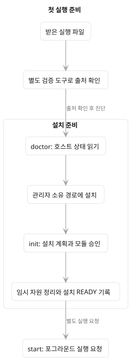

`doctor`는 관리자 권한으로 실행해도 호스트 상태를 읽기만 해요.
추가 권한으로 확인할 항목에는 `needs_privileged_check`를 표시해요.
초기화와 시작에서는 승인한 자원을 준비한 뒤 아래 조건을 직접 확인하고, 필수 조건에 어긋나면 중단해요.

* 운영체제와 실행 환경: Linux/amd64, EL9 네이티브 ABI, 배포 파일의 amd64-v2 CPU 요구 조건
* 서비스와 자원 관리: systemd 252 이상의 지정 기능과 cgroup v2 컨트롤러
* 프로세스 격리와 관측: namespace, seccomp, pidfd, openat2, systrap 및 Landlock 지원과 권한
* 호스트 저장소: XFS, loop, mount와 필요한 보안 정책 권한

운영자는 `chatanium init`이 보여 주는 준비 계획을 먼저 승인해요. 계획에는 호스트에 만들
전용 계정과 설치 경로, 저장 공간 예산처럼 호스트에 남는 변경을 적어요. 어떤 번들과
이미지를 가져오고 임시 준비 작업에 어떤 자원을 쓰는지도 계획에 담아요. Chatanium은 변경 전에
의도를 기록하고, 이미지 선언을 검사한 다음 운영자에게 모듈 권한을 별도로 승인받아요.
`allResources` 요청도 이 별도 승인에 포함해요.

이미지 준비를 마치면 Chatanium은 임시 작업을 종료하고 쓰기 참조를 닫아요.
이어서 제품 소유 마운트와 loop 연결을 해제해요.
정리를 확인한 뒤에만 구성과 승인 내용을 묶은 리비전을 활성화하고 설치 상태를 `READY`로 기록해요.
설치의 `READY`는 그 리비전으로 명시적 시작을 요청할 수 있는 상태예요. 준비가 끊기면
다음 `init`은 저장한 진행 기록부터 이어 가고, 정리가 불확실하면 복구 상태를 남겨요.

## 02. 승인할 이미지 확인

운영자가 모듈을 검토하려면 화면에서 읽은 선언과 나중에 실행할 이미지를 한 쌍으로 확인해야 해요.
레지스트리에서 이미지를 가져올 때는 태그로 대상을 찾아요. 같은 태그가 다른 내용을 가리킬 수 있으므로,
준비 작업은 태그를 한 번 해석한 뒤 찾은 이미지의 다이제스트를 확인해요.
다이제스트는 내용 자체의 식별값이에요. 준비 작업은 Linux/amd64용 OCI 매니페스트 하나를 고르고 그 바이트를 보존해요.

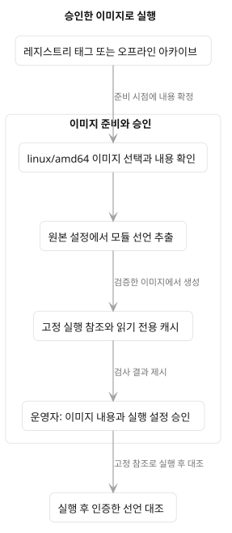

준비 작업은 선택한 OCI 이미지의 원본 설정에서 `org.chatanium.flexmodule.manifest.v2` 선언을 꺼내요.
매니페스트가 가리키는 설정과 레이어가 각각 기록과 일치하는지 확인하고, 원본 바이트에서 검사한 선언을
운영자에게 보여 줘요. 운영자는 모듈을 실행하기 전에 선언과 실행 설정을 검토해요. Chatanium은
그 승인을 정확한 이미지 식별값과 선언에 묶고, 어느 리비전에서 승인했는지 함께 기록해요.

파일로 이미지를 들여올 때도 다이제스트를 확인해요. OCI 아카이브는 검증한 원본 객체를 보존해요.
Docker-save 입력은 원본 아카이브의 식별값을 따로 저장해요. 설정과 레이어를 검증한 뒤 승인을 위해
OCI 매니페스트를 만들고, 그 파생 다이제스트는 로컬에서 만든 OCI 매니페스트의 식별값으로 표시해요.

준비 서비스는 제한된 환경에서 검증한 이미지로 실행용 캐시를 만들어요. 관리 프로세스는
승인한 환경의 준비 서비스가 캐시를 썼다는 근거를 기록해요. 쓰기 작업과 관련 참조가 끝났음을
확인한 뒤에만 캐시를 읽기 전용으로 봉인해 공개해요. Chatanium은 원본 OCI를 보관하고,
시작할 때 승인 기록에 적은 다이제스트로 전체 캐시를 찾아 실행 환경에 읽기 전용으로 연결해요.
실행 중 이미지 공급원은 이 캐시로 고정해요.
마지막으로 앱은 모듈을 인증한 뒤 받은 선언을 승인 기록과 대조해요.

## 03. 실행 허가와 준비 완료

운영자가 `chatanium start --foreground`를 요청하면 Chatanium은 설치 상태와 번들을 확인하고
이전에 남은 자원을 정리해요. root 관리 프로세스는 설치를 한 곳에서만 운영하도록 독점권인 lease를 확보해요.
실행 중인 관리 프로세스가 이미 lease를 갖고 있으면 새 시작 요청을 거절해요.
포그라운드 관리 프로세스는 systemd에 자기 scope를 등록하고 활성 멤버임을 확인해요.
이 scope에 하위 서비스의 수명을 연결해 관리 프로세스가 종료되면 systemd가 하위 서비스도 중지하도록 해요.

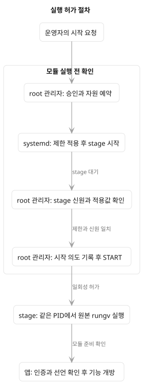

모듈을 요청하면 관리 프로세스는 현재 리비전의 승인과 자원 상한을 확인해요. systemd가 이 상한을
cgroup에 기록할 수 있는 유일한 주체예요. systemd는 해당 실행에 지정한 사용자와 제약을 적용하고
`stage`를 띄워요. `stage`는 원본 `rungv` 실행을 대기하면서 자신이 시작했음을 알려요.
관리 프로세스는 커널과 systemd에서 관측한 실행 식별값으로 그 프로세스를 확인해요. 실제 cgroup 값과
마운트 및 네트워크가 승인한 값과 일치할 때 대기 중인 인스턴스를 `CREATED`로 기록해요.

관리 프로세스는 lease와 현재 허용 상태를 다시 확인하고, 시작 의도를 영구 기록한 뒤 `START`를
한 번 보내요. `stage`는 그때 같은 PID에서 `rungv`로 전환해 게스트 초기화를 시작해요.
Chatanium은 이 사이 모듈에 부여할 운영 권한과 외부 통신을 닫아 둬요.
앱이 연결 상대를 인증하고 모듈이 보낸 매니페스트를 승인 기록과 대조한 뒤,
Chatanium은 인스턴스의 `READY`를 기록하고 승인한 범위만 활성화해요.

## 04. 다시 시작한 모듈의 파일 접근

모듈을 재시작해도 이전 파일을 쓰려면 호스트의 같은 디렉터리를 새 실행에 연결해야 해요.
`hostfs`가 이 디렉터리를 게스트에 보여 줘요. 호스트에서는 `rungv`의 전용 계정이 디렉터리를
소유하고, 게스트에서는 모듈에 승인한 UID와 GID로 파일 접근을 판단해요.
`hostfs`가 새 디렉터리의 게스트용 속성을 만들기 전에는 소유자를 `0:0`으로 보여 줘요.
첫 실행에서 게스트용 속성을 초기화하면 모듈이 승인한 계정으로 저장소에 접근할 수 있어요.

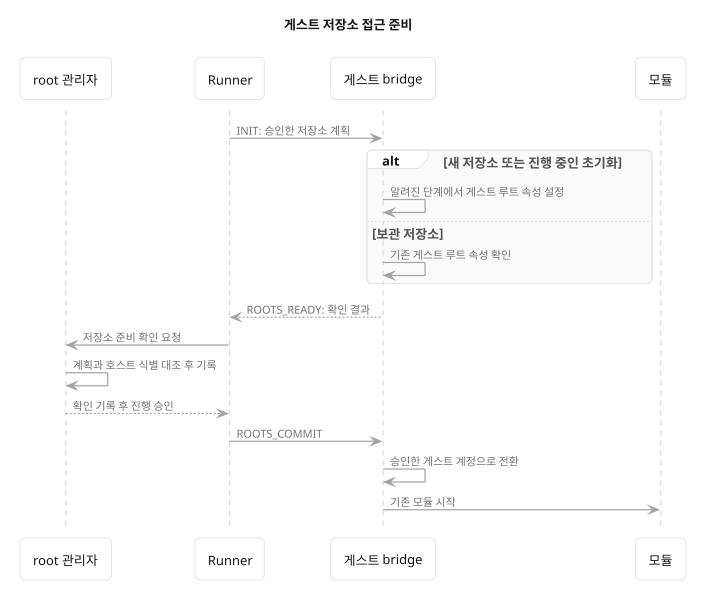

관리 프로세스는 초기화 전에 모듈에 연결할 디렉터리 목록과 각각의 승인 속성을 기록해요. 신뢰할 수
있는 게스트 브리지는 초기화 동안만 게스트의 관리자 권한을 써요. 새 디렉터리는 기록한 단계에 따라
디렉터리 자체의 게스트 속성을 맞추고 다시 읽어 확인해요. 보존해 둔 디렉터리에서는 속성을 읽어
승인과 대조해요. 보존 데이터의 속성이 다르면 시작을 멈추고 복구 대상으로 남겨요.

브리지가 `ROOTS_READY`로 결과를 보고하면 러너가 관리 프로세스에 확인을 요청해요.
관리 프로세스는 초기화 계획과 실제 호스트 대상을 대조하고 결과를 디스크에 기록한 뒤 진행을 승인해요.
러너는 이 승인을 받은 뒤 브리지로 `ROOTS_COMMIT`을 보내요. 브리지는 모든 스레드에
승인한 0 이외의 UID와 GID를 적용하고 초기화 권한과 파일 핸들을 정리해요.
전환 결과를 확인한 브리지는 같은 게스트 계정으로 기존 모듈을 실행해요.

초기화 중 중단되면 다음 실행은 이전 프로세스가 끝났다는 근거와 기록해 둔 단계에 따라 재개해요.
파일을 보존할 때는 게스트용 소유자와 모드를 담는 `hostfs` 메타데이터도 함께 다뤄요. 이 정보가
다음 실행에서 같은 디렉터리의 속성을 확인하는 근거가 되므로, 공간 예산과 백업에도 포함해요.

## 05. 기존 모듈 연결 유지

운영자는 `NONE`을 선택한 모듈에도 앱에서 요청을 보내고 모듈의 역방향 호출을 받을 수 있어요.
호스트와 게스트가 각자 Unix 소켓을 열고, `rungv`의 표준 입출력이 두 소켓 사이의 전송 통로가 돼요.
게스트에서 브리지는 모듈이 연 소켓에 접속해 전송 통로와 소켓 사이에 바이트를 넘겨요.

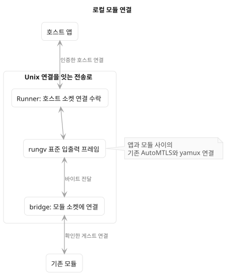

관리 프로세스는 호스트에서 통제하는 디렉터리에 Unix 소켓을 만들고 앱에 연결을 받을 파일 핸들을 건네요.
앱의 러너는 등록한 런타임 프로세스에서 온 연결 한 건만 받아요.
게스트 브리지는 모듈의 첫 핸드셰이크가 가리킨 소켓이 승인 범위 안에 있는지 확인해요.
호스트 앱이 기존 모듈 연결을 요청하면 러너는 검증한 게스트 경로를 호스트 소켓에 대응시켜요.

러너는 관리 프로세스에 실행을 요청하고 전송을 시작한 뒤 반환해요.
모듈이 핸드셰이크를 보내면 러너가 검증한 한 줄을 별도 파이프로 기존 go-plugin 연결 코드에 넘겨요.
모듈의 나머지 출력은 크기를 제한한 진단 기록으로 보내요.
Chatanium은 시작 기한 안에 핸드셰이크와 선언 확인까지 마쳐야 준비 완료로 처리해요.
그 전에 모듈이 종료하면 종료 코드가 0이어도 시작 실패로 기록해요.

기존 AutoMTLS가 연결 상대를 인증하고, 기존 yamux가 그 연결 하나에서 여러 호출을 운반해요.
Chatanium에서 모듈로 보내는 호출과 모듈에서 호스트로 되돌아오는 호출이 같은 연결을 써요.
브리지는 바이트 전달을 맡고, 호출 내용과 요청 권한 판단은 기존 프로토콜과 승인 규칙에 맡겨요.

## 06. 저장 공간과 실행 자원 예산

모듈 하나가 저장 공간을 많이 써도 다른 모듈을 운영할 여유를 남기려면, 설치 전체의 용량부터 정해야
해요. Chatanium은 제품 전용 파일에 크기가 정해진 XFS 저장소를 만들고 그 안에서 예산을 나눠요.
운영자는 승인 전에 아래 용도가 바이트와 inode 예산 안에 들어가는지 확인해요. inode 예산은 작은
파일을 많이 만들어도 다른 작업이 파일을 만들 여유를 남기기 위해 따로 정해요.

* 원본 이미지와 준비된 캐시의 보관 공간
* 이미지 준비 중 입력과 압축 해제 결과를 함께 둘 작업 공간
* 모듈별 보존 데이터와 임시 작업 공간
* 앱 데이터와 로그 및 XFS 자체에 필요한 여유 공간

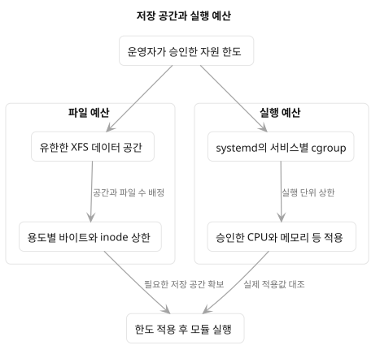

Chatanium은 모듈 디렉터리를 열기 전에 호스트 XFS의 프로젝트 quota를 적용해요. XFS가 바이트와
inode 상한을 실제로 강제하고, 새 파일에도 해당 디렉터리의 quota가 이어져요. 앱 데이터 공간도
전체 DATA 예산에서 떼어 예약해요. 초기 계획은 기본 32 GiB 안에 앱용 10 GiB와 inode
65,536개를 표시해요. 운영자가 이 값을 바꾸면 다른 데이터 예산까지 합산해 다시 판단해요.

디스크 상한과 함께 실행 중 쓸 자원도 제한해요. systemd가 호스트 서비스에 상한을 적용해요.
Chatanium은 적용값이 승인값과 정확히 일치할 때 시작해요. 이때 확인하는 상한은 다음과 같아요.

* CPU 상한: 정해진 기간에 인스턴스가 쓸 수 있는 CPU 시간
* 메모리 상한: `rungv`와 브리지를 포함한 게스트 실행 전체의 메모리, swap은 0
* 태스크 상한: 호스트에서 인스턴스가 만들 수 있는 프로세스와 스레드 수

기존 `max_pids`는 호스트 태스크 상한이에요. 승인한 배치를 담을 공간이 부족하면
Chatanium은 새 실행과 준비 요청을 거절해요. 관리 프로세스는 작업용 저장소 바깥에 기록을 남겨요.
모듈이 자기 공간을 다 써도 관리 프로세스는 예약과 정리 결과를 계속 기록할 수 있어요.

## 07. 승인한 공개망 연결

모듈이 외부 공개 서비스에 접속해야 한다면, 운영자는 초기화할 때 어떤 네트워크 구성을 허용할지 정해요.
Chatanium은 그 선택을 리비전에 기록하고, 인스턴스마다 한 가지 구성을 고정해요.
실행 중에는 같은 구성 안에서 권한을 열거나 닫아요. 주소 계열을 바꾸려면 새 인스턴스를 시작해요.
운영자가 고를 수 있는 구성은 세 가지예요.

* `NONE`: 루프백만 사용하는 모듈 실행 환경
* `PUBLIC-v4`: IPv4 공개망 통신과 외부 IPv6 차단
* `PUBLIC-dual`: IPv4와 IPv6 공개망 통신, IPv6 전달과 NAT66 지원 필요

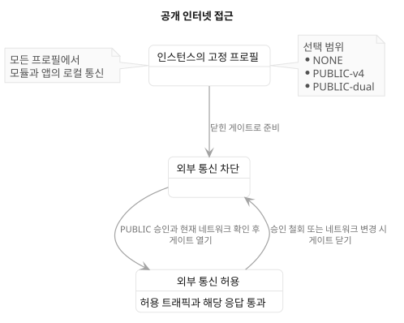

PUBLIC에서는 인스턴스마다 호스트가 운영하는 별도 네트워크 공간을 마련해요.
관리 프로세스는 방화벽 규칙의 순서와 주소 계열별 전달 및 변환을 확인해요.
인스턴스에 배정한 주소와 선택한 송신 인터페이스에만 NAT를 적용해요.
이 조건을 모두 확인한 뒤 통신을 열어요. `PUBLIC-dual`에서는 두 주소 계열에 같은 절차를 거쳐요.

필터는 호스트 자신과 내부망처럼 공개 통신에서 제외할 목적지를 먼저 걸러요.
그다음 허용하는 공개 트래픽과 승인한 DNS 해석기로 가는 요청을 통과시켜요.
응답은 필터가 추적한 허용 연결에 속할 때만 통과해요. 모듈이 DNS 응답의 주소로 새 요청을 보내면,
필터는 새 목적지에도 같은 기준을 적용해요.
지정 DNS 규칙의 적용 범위는 승인한 해석기로 가는 TCP/UDP 53이에요.
공개 HTTPS 안의 DoH는 일반 공개 HTTPS에 쓰는 목적지 규칙을 따라요.

승인을 철회하거나 호스트 네트워크의 변화를 관측하면 관리 프로세스는 우선 통신을 닫아요. 두 주소
계열을 차단한 뒤 기존 연결 추적 기록을 양방향에서 지워요. 이 절차가 실패하면 링크를 내리고 서비스를
중지해 차단을 유지해요. 네트워크 상태를 다시 확인한 뒤에만 재허용하고, 주소는 종료 후 연결과 소유
네트워크 자원까지 정리한 뒤에 반환해요.

## 08. 호스트에서 주소 예약

같은 호스트에서 여러 설치가 PUBLIC 모듈을 실행하려면 각 인스턴스가 쓸 주소 대역을 따로 확보해야
해요. PUBLIC 인스턴스에는 IPv4 `/30`을 예약하고, `PUBLIC-dual`에는 내부용 IPv6 ULA
`/126`도 예약해요. 관리 프로세스는 이 대역에서 호스트와 인스턴스 양쪽에 주소를 배정하고,
인스턴스가 호스트 쪽을 거쳐 나가도록 기본 경로를 정해요.

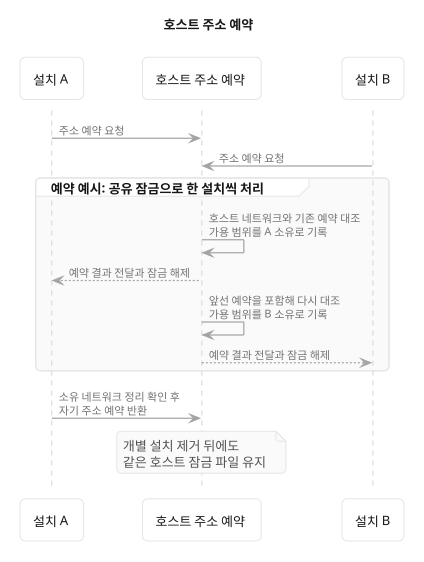

대역을 고르려면 호스트의 기존 주소와 기본 경로를 제외한 라우팅을 먼저 살펴야 해요.
관리 프로세스는 다른 인프라와 기존 예약까지 확인해 쓸 수 있는 범위를 골라요.
이렇게 호스트에서 주소 대역을 찾아 예약하고 반환하는 기능을 IPAM이라고 해요.

두 설치가 동시에 여유 대역을 찾으면 같은 범위를 고를 수 있어요.
예약 기록을 한 설치씩 갱신하도록 운영자는 PUBLIC 초기화 때 `/var/lib/chatanium/network-ipam`과 공유 잠금을 승인해요.
관리 프로세스는 잠금을 잡은 뒤 호스트 상태를 살피고 대역을 예약 기록에 추가해요.
기록을 갱신한 뒤에 잠금을 풀기 때문에 다음 설치는 앞선 예약까지 확인하고 자기 대역을 골라요.

관리 프로세스는 인스턴스를 종료하고 네트워크와 잔여 연결을 정리한 뒤에야 대역을 반환해요.
설치를 파기할 때도 자기 예약만 반환하고, 다음 설치를 위해 공용 디렉터리와 잠금 파일은 보존해요.
잠금 파일을 교체하면 대기 중인 설치는 기존 파일을, 뒤따르는 설치는 새 파일을 잠글 수 있어요.
두 잠금이 따로 움직이면 예약 순서가 깨지므로 모든 설치가 계속 같은 파일을 사용해요.
`NONE`은 루프백만 쓰므로 IPAM은 PUBLIC 설치에서만 준비해요.
설치 변경 순서를 조정하는 공용 관리 잠금은 네트워크 구성과 관계없이 유지해요.

## 09. 중지와 복구

운영자가 `chatanium stop`을 요청하면, 실행 중인 관리 프로세스는 인증한 요청을 받아 목표 상태인
`STOPPED`부터 기록해요. 그다음 새 실행 요청을 닫고 진행 중인 작업을 정리해요. 관리 프로세스가
재시작하더라도 기록이 `STOPPED`면 복구만 수행해요. 운영자가 명시적으로 시작을 요청할 때 새 실행
의도를 기록해요. systemd가 관리 프로세스를 먼저 종료한 경우에는 자원별 기록을 바탕으로 복구해요.

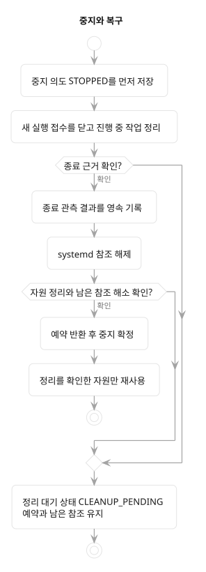

복구할 때는 실행을 요청했다는 기록과 실제 실행을 확인했다는 기록을 나눠 봐요. systemd에 보낸
요청의 응답이 끊기면 요청은 `SUBMITTED`에 남아요. 관리 프로세스는 systemd가 요청을 거부했다는
확정 기록이나 이전 부팅의 작업이 종료됐다는 근거를 확보할 때까지 해당 자원 예약을 유지해요.
`OBSERVED` 기록이 있으면 관측한 그 실행 건을 기준으로 종료 또는 전체 자원 부재를 확인해요.

정상 중지에서는 관리 프로세스가 권한과 외부 연결을 철회하고, 유한한 기한 안에서 서비스와 전송을
정리해요. systemd에서 얻은 종료 관측을 영구 기록한 다음에 `Unref`로 해당 서비스 참조를 풀어요.
그 뒤 작업과 프로세스가 사라지고, 표준 입출력과 마운트를 비롯한 참조까지 해소됐는지 확인해요.
임시 데이터가 점유하던 quota를 실제로 회수한 뒤에야 자원 예약을 반환하고, 보존 데이터는 남겨요.

게스트가 보낸 종료 정보는 진단에 써요. 호스트 측 최종 결과가 미확인이면 종료 결과는 `UNKNOWN`으로 표시해요.
정리 근거가 부족하면 `CLEANUP_PENDING`으로 기록하고 관련 예약과 번들 및 캐시 참조를 보존해요.
이전 관리 프로세스의 사망을 확인하고 유지보수 lease를 얻은 뒤에만 오프라인 복구를 시작해요.
복구는 이전 세션을 폐기하며 다음 실행은 새 세션과 새 연결을 사용해요.

## 10. 서비스 등록과 설치 제거

포그라운드 실행을 마친 뒤 부팅 시에도 운영하려면 `service install --enable --now`를 선택해요.
Chatanium은 정리가 끝난 `READY` 설치를 확인하고 관리용 systemd 서비스만 등록해요.
명시적인 `--now` 요청은 새 `RUNNING` 의도를 기록하고 lease를 반환한 뒤 서비스를 활성화하고 시작해요.
서비스 진입과 자동 재시작은 기록한 목표 상태를 따라요.
서비스로 운영할 때도 포그라운드와 같은 승인 및 정리 절차를 사용해요.

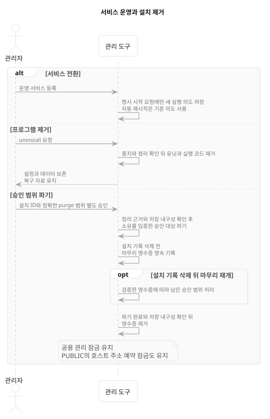

프로그램을 지우고 보존 데이터를 남기려면 `uninstall`을 사용해요. Chatanium은 중지 후 유지보수
lease를 다시 확보하고 실행 중인 소유자와 미해결 정리가 없는지 확인해요. 이 조건을 충족하면 자기
코드와 서비스를 제거해요. 나중에 이 설치를 복구하거나 파기할 수 있도록 다음 대상을 보존해요.

* 설치 설정과 비밀
* 설치 ID와 전용 계정의 식별 정보
* 데이터와 원본 이미지
* 복구에 필요한 번들

보존한 데이터까지 지울 때는 `purge`에서 설치 ID와 정확한 파기 범위를 따로 승인해요. 프로그램을
이미 지웠다면 호환되는 실행 파일을 다시 검증해 보호 경로에 놓고, 보존된 설치 ID를 대상으로 작업해요.
관리 프로세스는 실행 작업이 끝났고 데이터와 마운트에 열린 참조가 없는지 확인해요. 기록에서 제품
소유를 입증한 대상만 지우며, 계정은 제품이 만든 비공유 계정임을 확인한 경우에만 지워요.

첫 파기 작업에 앞서 관리 프로세스는 메타데이터 파일시스템에서 승인한 사전 시험 두 건을 수행해요.
파일의 공개와 교체가 성공하고 시험 파일 삭제까지 디스크에 반영됐는지 확인한 뒤 파기를 시작해요.
관리 데이터베이스를 지우기 전에는 별도 마무리 기록에 승인 범위와 진행 단계를 저장해요.
데이터베이스를 지운 뒤 중단되면 관리 프로세스는 마무리 기록을 검증해요.
그 기록에 따라 승인 범위의 남은 관리 파일 정리만 이어 가요.
선택한 대상의 삭제를 마치고 그 결과를 디스크에 반영한 뒤 마무리 기록도 제거해요.

전체 파기 후에도 설치 변경을 조정하는 호스트 공용 관리 잠금은 같은 파일로 남겨요. PUBLIC을 사용한
호스트에서는 공유 주소 관리 디렉터리와 잠금도 보존해, 다른 설치가 같은 방식으로 예약을 이어 가게 해요.

## 11. 새 릴리스 준비와 승인

기존 설치에 새 릴리스를 적용하려는 운영자는 새 실행 파일을 검증하고 보호 경로에 따로 둬요.
새 실행 파일로 교체용 이미지를 준비하는 동안 현재 설치의 번들과 리비전은 그대로 유지해요.
운영자는 준비 결과를 검토하고 정확히 어떤 이미지로 교체할지 승인한 뒤 갱신을 요청해요.

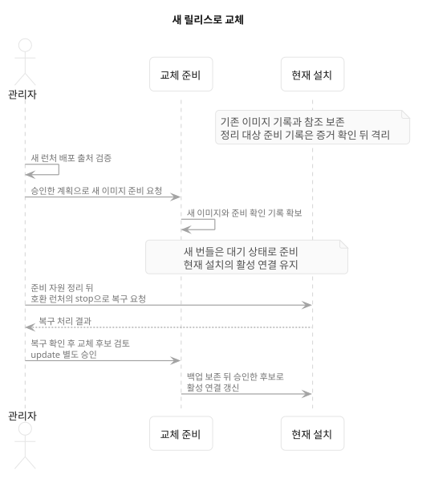

교체 후보를 고르려면 먼저 예전 준비 기록을 살펴요. 처음 이미지를 준비한 작업이
현재의 격리 및 쓰기 조건을 충족했다는 근거가 있어야 기존 준비 결과를 재사용해요.
현 버전의 재사용 기준 밖인 구 형식 기록은 당시 근거가 온전히 남은 경우 정리에만 써요.
관리 프로세스는 완료 이력과 원본 이미지에서 캐시까지의 연결을 확인한 뒤 대상 기록을 격리해요.
이미지 정리에 필요한 참조는 계속 보존해요.

현재 실행 파일이 구 준비 방식을 쓰는 설치에서는 검증한 새 실행 파일로 `prepare-image`를 요청해요.
운영자는 현재 리비전에서 교체할 이미지를 지정한 뒤 그 이미지의 정확한 준비 계획을 승인해요.
새 실행 파일은 후보 이미지와 캐시를 준비해 결과를 기록하고 임시 자원을 정리해요.
현재 번들과 리비전의 활성 설정은 이 과정에서 유지해요. 미해결 작업도 복구 대상으로 계속 추적해요.

준비 작업의 연결 해제를 확인하면 호환되는 검증 실행 파일에서 `stop`으로 이전 작업의 복구를 명시적으로
요청해요. 그 뒤 새 실행 파일로 `update`를 요청해 전체 교체 후보를 별도 승인해요. `update`는 기존
모듈 구성을 보존하고, 각 모듈에 승인한 준비 계획과 정확히 일치하는 새 이미지 및 캐시를 선택해요.
일치하는 결과를 하나로 확정할 수 있을 때만 교체를 진행해요.

`update`는 중지와 마운트 해제를 확인한 뒤 저장 형식의 호환성을 검토하고 백업을 보존해요. 별도 승인
범위에서 설정과 실행 파일을 교체하고 새 리비전을 활성화해요. 복구가 필요할 때는 참조 중인 세대를
보존하고, 이전 실행 파일을 다시 쓰는 작업과 데이터를 복원하는 작업을 각각 판단해요. 기존 Docker
데이터를 연결해 쓰려면 별도로 승인한 오프라인 이관부터 진행해요.

전환에 맞춰 운영과 개발 명령도 보호된 실행 파일을 사용해요. 개발 watcher는 설치 ID로 `inspect-config`를
호출해 확정한 설정을 읽고, 교체 직전에 다시 확인해요. watcher는 데이터 마운트 바깥의 승인된 잠금
파일로 실행 순서를 조정하므로, 중지할 때 앱 데이터 마운트는 별도로 해제할 수 있어요. 빌드에 필요한
Docker는 빌드 쪽에 둘 수 있고, 배포 실행은 새 Chatanium 경로를 사용해요.
