# Chatanium 자체 포함 런타임

Chatanium을 설치한 뒤 모듈을 실행하려면 실행 엔진과 이미지 준비가 함께 맞물려야 해요.
이 설계는 배포 실행 파일에 원본 `rungv`를 담고,
Chatanium이 승인한 자원의 준비부터 실행과 정리까지 이어서 관리하는 흐름을 제안해요.
설계 단계는 Draft이고, 설명 근거는
[제공된 런타임 제안서](../../chatanium-0-self-contained-runtime.md)와 원문에 기록한 소스 검토예요.

## 설치와 초기화

사용자는 검증한 Chatanium 배포물에서 설치를 시작해요.
배포물에 원본 `rungv`를 포함하므로 제품 실행에 필요한 엔진도 함께 확보해요.
배포물을 처음 신뢰할 때는 별도로 신뢰한 릴리스 검증 수단으로 출처를 확인해요.
이후 root 소유의 `/usr/local/bin/chatanium`에 실행 파일을 설치하고 초기화 계획을 검토해요.

초기화에 앞서 `doctor`로 호스트 상태를 살펴볼 수 있어요.
`doctor`는 root로 실행해도 읽기 진단만 수행하며,
추가 권한이 필요한 확인은 `needs_privileged_check`로 표시해요.
실제 자원을 만들고 제한을 확인하는 작업은 사용자가 승인한 초기화에서 진행해요.

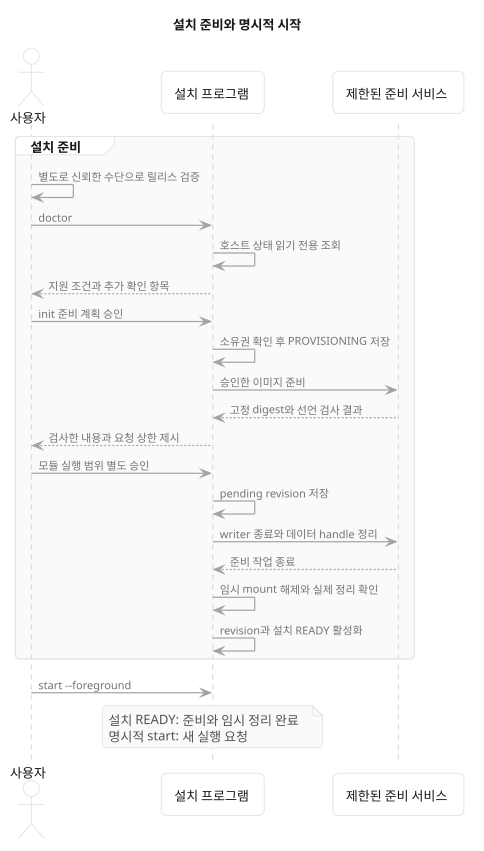

첫 지원 대상은 EL9 실행 호환성을 갖춘 Linux/amd64 호스트예요.
설치 프로그램은 systemd 252 이상의 지정 기능과 cgroup v2를 확인하고,
해당 배포물의 `amd64-v2` CPU 조건과 필요한 호스트 기능도 함께 확인해요.
지원 조건을 충족하는 호스트에서 승인한 제한을 그대로 적용하며,
조건이 부족하면 초기화를 중지해요.

초기화는 호스트에서 바꿀 내용을 사용자에게 먼저 보여 줘요.
사용자가 계정과 저장 공간을 포함한 준비 계획을 승인하면,
설치 프로그램은 유지보수 잠금인 `lease`를 확보해 다른 관리 작업과 순서를 맞춰요.
첫 준비 상태를 영속 기록한 뒤 제품 소유의 유한한 일반 파일에 저장소를 마련하고,
이미지 검사를 마치면 그 결과로 모듈이 요청한 기능의 승인을 따로 받아요.

준비 도중 중단하면 다음 초기화가 기록한 미완료 작업부터 조정해요.
준비를 마친 뒤에는 임시 작업의 쓰기 주체와 열린 데이터 참조를 해소하고,
제품 소유 마운트와 loop 연결까지 정리한 다음 설치를 `READY`로 전환해요.
이때 `READY`는 설치 준비 완료를 뜻해요.
사용자가 `start --foreground`를 명시하면 실제 실행 흐름을 시작해요.

## 이미지 고정과 승인

사용자가 승인한 모듈을 실행하려면 승인 때 확인한 내용과 실행할 내용이 같아야 해요.
이미지 태그는 나중에 다른 내용을 가리킬 수 있으므로,
이미지 준비 프로그램인 preparer가 태그를 한 번 해석한 뒤 실제 내용의 digest를 기록해요.
이 기록으로 검사한 이미지와 이후 실행할 이미지를 연결해요.

이미지가 요청하는 기능은 원본 OCI config의 선언에서 읽어요.
준비 프로그램은 `org.chatanium.flexmodule.manifest.v2`를 검사하며,
검사하는 동안 모듈 실행은 보류해요.
사용자는 이 선언과 고정한 이미지 내용을 함께 확인하고 실행 범위를 승인해요.

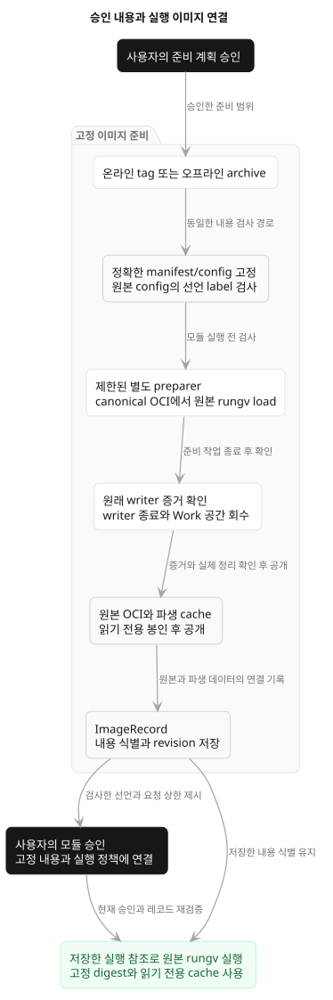

이미지 준비 프로그램이 승인한 범위에서만 파일을 쓰도록 실행 환경을 제한해요.
별도 계정의 preparer에 유한한 자원 한도를 적용하고 외부 쓰기 handle 주입도 차단해요.
관리 프로그램은 preparer의 실제 프로세스와 private USER namespace의 소유 관계를 확인하고,
preparer의 모든 스레드가 승인한 계정과 실행 자격을 사용하는지도 대조해요.
모든 스레드에 고정한 준비 필터를 적용했다는 증거를 저장한 뒤 데이터 작업을 허가해요.
이 증거는 원래 이미지를 준비한 쓰기 주체를 추적하는 근거예요.

작업이 끝나면 관리 프로그램은 원래 쓰기 주체의 증거를 다시 대조해요.
준비 서비스와 남은 스레드가 종료하고 private namespace까지 해소했는지 확인한 뒤,
변환 결과를 그 자리에서 root 소유의 읽기 전용 세대로 봉인해요.
임시 작업 공간의 실제 사용량을 회수하고 공개 의도를 기록한 다음,
봉인한 세대를 공개하고 완료 기록을 남겨요.

원본 OCI 내용은 이후에도 이미지 식별의 기준으로 보존해요.
실행용 EROFS는 원본을 변환한 결과이므로,
검증한 archive와 고정한 변환 도구가 두 내용을 연결해요.
실행 중에는 완성한 cache 전체를 읽기 전용으로 공유하고,
실행 또는 복구가 참조하는 세대를 보존해요.

온라인 획득과 오프라인 반입은 같은 내용 확인 흐름으로 합류해요.
준비 프로그램은 각 입력을 검사한 뒤 원본 내용을 보존하는 정규 OCI archive를 만들어요.
승인은 원본과 선택한 실행 내용에 결부하고,
실행 프로그램은 저장한 레코드의 digest로 읽기 전용 cache를 고르고 고정한 옵션을 사용해요.
이렇게 고정한 내용을 다음 단계에서 역할별로 나누어 실행해요.

## 실행과 관리의 분리

모듈을 실행하는 동안에는 앱의 비밀과 호스트 자원을 각각 필요한 주체가 다뤄야 해요.
사용자는 작업 범위를 승인하고, root 관리 프로그램인 root supervisor가
그 승인에 맞춰 운영체제 자원과 실행 수명을 관리해요.
관리 프로그램은 현재 실행 주체와 승인 상태를 다시 확인한 뒤 요청을 처리해요.

앱은 별도 계정에서 bot token과 모듈 연결을 맡아요.
모듈 실행은 앱과 구분한 sandbox 계정에 맡기고,
이미지 준비도 전용 preparer 계정에서 수행해요.
관리 프로그램은 앱의 bot token을 앱에 전달하고,
실행 엔진과 이미지 준비 과정에는 각각 필요한 입력만 제공해요.

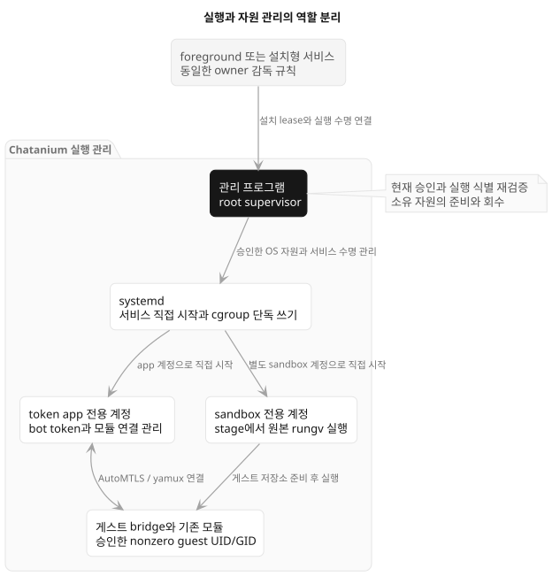

이 역할을 실제 호스트 제한으로 연결하는 주체는 systemd예요.
systemd가 각 서비스를 직접 시작하고 cgroup을 단독으로 관리해요.
관리 프로그램은 승인한 제한을 systemd에 요청한 뒤 실제 적용값을 확인해요.
sandbox 계정은 이 제한 안에서 원본 `rungv`를 실행해요.

포그라운드 실행에서는 등록한 owner scope를 전체 실행의 기준으로 삼아요.
서비스 실행에서는 관리 프로그램의 서비스가 같은 역할을 맡아요.
systemd는 하위 서비스를 정확한 owner에 연결해 수명을 묶고,
관리 프로그램은 별도로 통신 철회와 실제 자원 정리를 확인해요.
두 실행 방식에 같은 승인과 정리 규칙을 적용하므로,
사용자가 실행 방식을 바꿔도 모듈의 허용 범위와 종료 기준을 이어 가요.

## 시작 전 확인과 실행 허가

실행을 요청한 사용자는 승인한 제한 아래에서 모듈이 시작하기를 기대해요.
원본 `rungv run`은 생성과 실행을 이어서 수행하므로,
Chatanium은 앞단의 stage에 실행 허가를 기다리는 gate를 마련해요.
관리 프로그램은 이 gate에서 호스트 상태를 확인한 뒤 원본 엔진 실행을 허가해요.

관리 프로그램은 먼저 현재 이미지와 자원 승인을 확인하고 생성 의도를 영속 기록해요.
제한과 닫힌 네트워크를 준비한 다음에는 생성 요청을 `SUBMITTED`로 기록하고,
systemd에 제한된 stage 시작을 요청해요.
systemd는 sandbox 계정과 호스트 제한을 적용한 상태에서 stage를 시작해요.

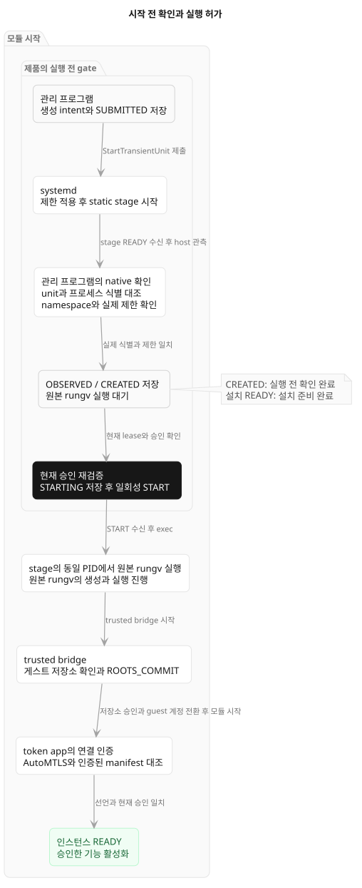

stage가 준비 신호를 보내면 관리 프로그램이 실제 호스트 증거와 대조해요.
정확한 서비스 실행과 프로세스를 확인하고,
namespace와 실제 cgroup 제한이 승인한 값에 맞는지 확인해요.
확인을 마치면 `CREATED`를 기록해요.
이 단계에서는 stage가 원본 `rungv` 실행을 gate 뒤에서 대기시켜요.

실행 직전에는 현재 승인과 실행 소유 상태를 다시 확인해요.
관리 프로그램은 `STARTING`을 기록한 뒤 한 번의 `START`를 보내고,
stage는 같은 프로세스에서 원본 `rungv`로 전환해요.
gate의 기한 초과나 연결 오류는 해당 실행의 중지로 이어져요.

엔진 시작 뒤에도 모듈 기능은 인증을 마칠 때까지 닫아 둬요.
게스트 저장소 준비를 끝내고 AutoMTLS로 연결 상대를 인증한 다음,
앱은 인증한 모듈의 선언을 사전에 승인한 선언과 비교해요.
모든 확인을 마친 instance의 `READY`에서 승인한 기능을 열어요.
승인이나 선언이 어긋나면 관리 프로그램은 모듈을 중지해요.

## 게스트 저장소 준비

사용자는 모듈을 다시 시작해도 보관한 파일을 같은 소유 관계로 사용해야 해요.
호스트에서는 sandbox 계정이 저장소를 소유하고, 게스트 모듈은 승인한 계정으로 파일을 사용해요.
`hostfs`는 호스트 파일을 게스트에 연결하면서 게스트용 소유 속성을 따로 관리하므로,
Chatanium은 두 환경에서 실제 파일 사용자가 필요한 접근을 갖추도록 저장소를 준비해요.

`hostfs`는 가상 metadata 생성 전의 디렉터리 소유자를 게스트 `0:0`으로 보여 줘요.
따라서 호스트 소유권 설정 뒤에 게스트에서 사용할 소유 속성도 준비해야 해요.
관리 프로그램은 승인한 최상위 저장 디렉터리의 계획을 작성하고,
신뢰하는 guest bridge에 그 유한한 계획을 전달해요.

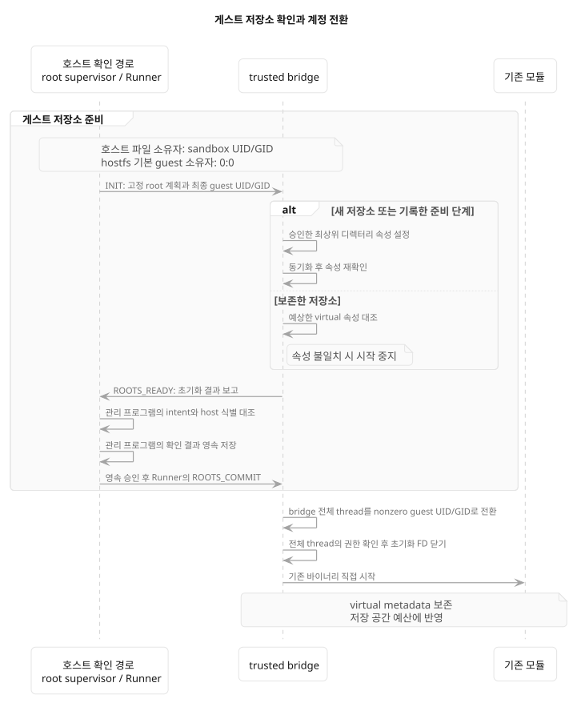

새 저장소에서는 bridge가 게스트의 root 계정으로 계획한 최상위 디렉터리의 속성을 설정하고 다시 읽어 확인해요.
중단했던 준비는 기록한 단계와 일치하는 상태에서 이어 가요.
기존 저장소에서는 보관한 속성을 확인하며,
속성이 어긋나면 복구 오류로 중지해 원래 상태를 보존해요.
초기 속성 변경은 승인한 최상위 디렉터리를 대상으로 수행해요.

bridge가 `ROOTS_READY`로 준비 결과를 보고하면 root 관리 프로그램이 자기 기록과 호스트 식별을 대조해요.
관리 프로그램은 기대한 준비 결과를 영속 확인한 뒤 `ROOTS_COMMIT`을 허가해요.
이 확인이 끝나야 bridge가 다음 단계로 진행해요.
따라서 게스트의 준비 보고와 실제 모듈 시작 사이에 호스트의 확인을 한 번 더 거쳐요.

`ROOTS_COMMIT` 뒤에는 bridge가 모든 스레드의 실행 자격을 낮춰요.
승인한 nonzero UID/GID를 적용하고 남은 권한을 정리한 결과를 확인한 뒤,
원래 모듈을 직접 시작해요.
bridge도 같은 제한된 자격으로 통신을 맡아요.
저장소의 가상 metadata는 데이터와 함께 보존하고 공간 예산과 백업에 포함해요.

## 기존 모듈 통신 유지

저장소 준비 뒤에는 기존 모듈이 원래 방식으로 앱과 연결해야 해요.
외부 통신을 `NONE`으로 선택한 모듈도 앱과 RPC를 주고받아야 하므로,
Chatanium은 게스트의 Unix 연결을 엔진의 표준 입출력으로 운반해요.
호스트에서는 별도의 native Unix socket을 앱의 연결 지점으로 제공해요.

이 두 연결 지점 사이에서 bridge와 runner는 통신 bytes를 frame에 담아 전달해요.
기존 AutoMTLS와 하나의 yamux 연결은 이 경로 안에서 그대로 동작해요.
모듈이 호스트 기능을 호출하는 역방향 RPC도 같은 yamux 연결을 사용하므로,
모듈 바이너리와 `core-v2`의 통신 의미를 유지해요.

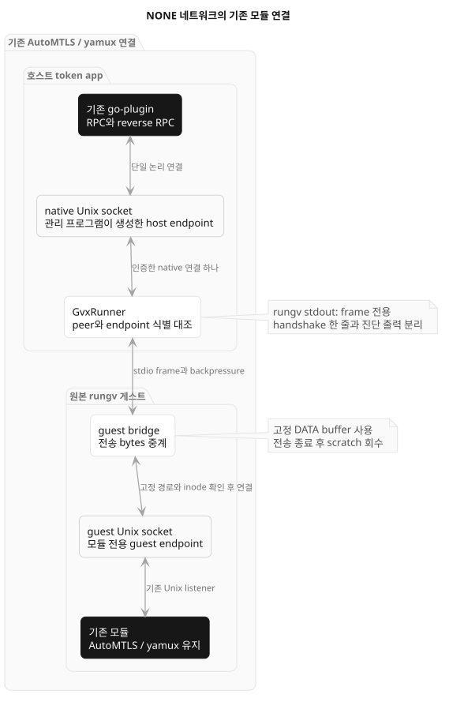

연결 지점마다 실제 상대를 확인하는 과정도 필요해요.
호스트는 등록한 runtime의 프로세스와 socket 접속 상대가 일치하는지 확인해요.
게스트는 지정한 socket 디렉터리 안의 정확한 경로와 파일 속성을 검사하고,
검사한 inode를 고정한 뒤 그 대상으로 연결해요.
bridge는 이 연결의 bytes를 운반하고, 기존 인증과 RPC 처리는 원래 계층이 맡아요.

runner는 handshake 한 줄을 별도 pipe로 전달해 전송 bytes와 진단 출력을 구분해요.
원본 `rungv`의 stdout은 frame 전용으로 사용하고,
모듈 출력과 오류 로그는 크기를 제한한 진단 경로로 보내요.
전송에는 고정 크기 buffer와 backpressure를 적용하므로,
느린 수신자가 생기면 송신 속도를 맞추며 승인한 메모리 안에서 처리해요.

종료 때는 새 연결을 닫고 진행 중인 입출력을 취소해요.
reader를 종료시킨 뒤 연결 처리와 pump의 종료를 기다리고,
마지막 연결에 필요한 경로 참조까지 닫은 다음 scratch를 회수해요.
이 순서는 통신이 끝났다는 확인과 임시 공간 반환을 연결해요.
다음 절에서는 이 공간을 포함한 전체 자원 예산을 살펴봐요.

## 자원 예산과 공간 회수

사용자가 승인하는 실행 예산에는 모듈을 움직이는 엔진 비용도 들어가야 해요.
systemd의 호스트 cgroup은 원본 `rungv`와 bridge를 포함한 게스트 실행 전체를 계상해요.
유한하게 둔 tmpfs도 같은 메모리 한도에 포함하고,
관리 프로그램은 시작 전에 실제 적용값을 승인과 대조해요.

`TasksMax`와 기존 `max_pids`는 호스트의 task와 thread 수를 제한해요.
이 기준으로 엔진을 포함한 호스트 실행 비용을 관리해요.
CPU 제한 역시 호스트가 정확히 표현할 수 있는 승인값을 사용하며,
승인값을 표현하기 어려우면 관리 프로그램이 실행을 중지해요.

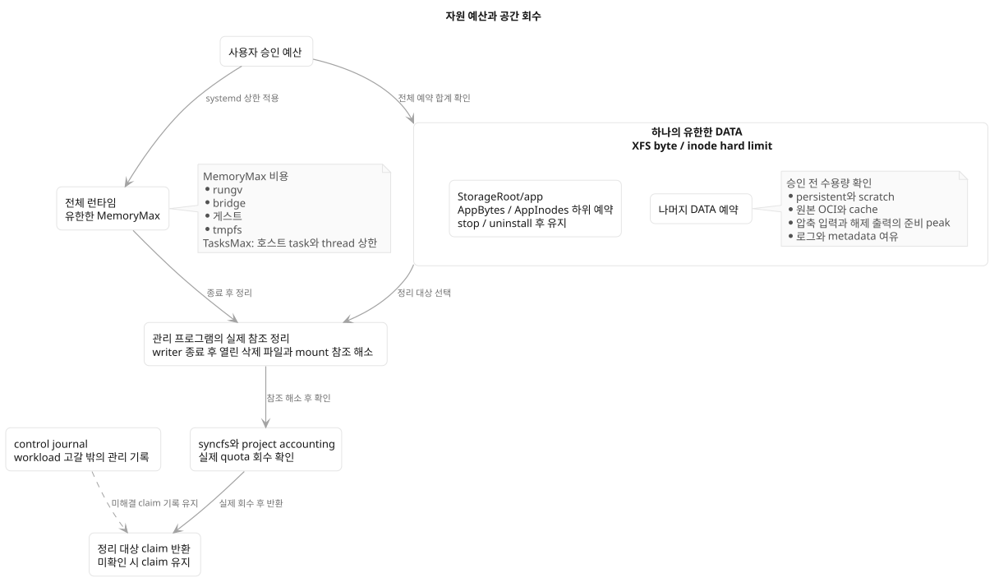

디스크에는 XFS의 byte와 inode hard limit을 적용해요.
관리 프로그램은 유한한 DATA 저장소 안에서 이미지 준비에 필요한 최대 사용량을 예약해요.
압축 입력을 보관하면서 변환 출력을 만드는 순간의 공간도 이 예약에 포함해요.
모듈의 보관 데이터와 scratch도 같은 전체 예산 안에서 승인해요.

앱의 데이터도 이 DATA 예산을 함께 사용해요.
앱은 `StorageRoot/app`을 관리 root로 사용하고,
관리 프로그램은 `AppBytes`와 `AppInodes`를 DATA의 하위 예약으로 잡아요.
따라서 앱 예약까지 포함한 전체 합계가 실제 저장 용량에 들어가야 해요.
관리 프로그램은 backing mount와 quota 예약을 확정한 뒤 쓰기 가능한 앱 상태를 공개해요.

앱 로그는 크기와 보관량을 제한하고, 저장소 metadata도 공간 사용량에 포함해요.
앱 예약은 stop과 uninstall 뒤에도 보존해요.
운영 상태를 추적하는 control journal은 workload가 고갈시키는 공간 밖에 두고,
관리 프로그램은 미해결 자원 예약을 계속 기록해요.
전체 예산에 여유가 부족하면 새 준비와 실행을 보류해요.

사용이 끝난 공간은 실제 반환을 확인해야 다음 작업에 줄 수 있어요.
관리 프로그램은 삭제한 파일을 붙잡은 열린 참조와 metadata writer를 닫고,
마운트 참조까지 해소한 뒤 동기화와 quota 계상으로 반환량을 확인해요.
회수를 확인한 자원의 예약을 완료 처리하고,
확인이 남은 자원은 예약을 유지해 다음 실행의 예산에도 반영해요.

## 외부 통신 허용과 철회

사용자는 모듈에 외부 통신이 필요한지 선택해요.
`NONE`은 엔진의 외부 네트워크를 닫고 기존 모듈 IPC를 유지해요.
`PUBLIC`을 승인하면 설치 때 선택한 family profile에 맞춰 외부 통신을 준비해요.
profile은 revision에 고정하며, family를 바꿀 때는 새 instance를 만들어요.

이 선택을 실행 중에도 통제하려면 호스트에서 통신을 닫을 지점이 필요해요.
Chatanium은 원본 `rungv`의 NAT 바깥에 제품 소유 network namespace를 두고,
그곳의 연결과 호스트 정책을 관리해요.
준비 중에는 통과 지점을 닫아 둔 채 선택한 profile의 실제 경로를 확인해요.

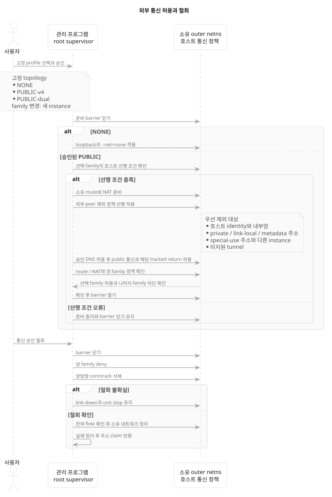

사용자가 선택할 topology는 다음과 같아요.

* `NONE`: loopback과 `--net=none`
* `PUBLIC-v4`: 승인한 IPv4 외부 통신과 연결 양끝의 IPv6 차단
* `PUBLIC-dual`: 승인한 IPv4와 IPv6 외부 통신

관리 프로그램은 선택한 profile의 forwarding과 NAT 조건을 확인해요.
`PUBLIC-dual`에는 사용할 IPv6 출발 주소와 NAT66 지원도 필요해요.
필수 조건을 갖춘 profile로 준비를 진행하며, 조건이 부족하면 해당 준비를 중지해요.

외부 peer 제외 정책을 먼저 적용한 뒤 승인한 resolver와 public traffic을 허용하고,
그 흐름의 추적된 응답도 같은 정책으로 확인해요.
DNS 응답으로 얻은 내부 목적지도 제외 정책에 따라 차단해요.
양 family의 허용 또는 차단 상태와 실제 경로를 확인한 뒤 통과 지점을 열어요.

승인을 철회하면 관리 프로그램은 통과 지점을 먼저 닫아요.
이어 양 family를 차단하고 양방향 conntrack 상태를 제거해 기존 흐름도 정리해요.
철회 결과가 불확실하면 link-down과 서비스 중지를 유지해요.
호스트 네트워크가 바뀔 때도 먼저 철회하고 새 상태를 확인한 뒤 다시 허가해요.

종료 뒤에는 소유한 네트워크 객체와 남은 흐름의 정리를 확인해요.
이 확인까지 마쳐야 해당 instance가 사용한 주소 예약을 반환해요.
여러 설치가 같은 호스트에서 주소를 고를 때도 이 예약이 서로 맞물려야 하므로,
다음 절에서는 설치 간 주소 선택 순서를 이어서 살펴봐요.

## IPAM 주소 예약

여러 Chatanium 설치가 한 호스트에서 PUBLIC 연결을 만들면 연결마다 독립된 주소 범위가 필요해요.
새 범위는 호스트가 이미 쓰는 주소와 구분해 확보해야 해요.
IPAM은 이 주소 선택과 예약을 관리하는 기능이에요.
관리 프로그램은 호스트 주소와 비기본 route를 확인하고,
다른 설치의 예약도 반영해 사용할 범위를 골라요.

여러 설치가 같은 기준으로 예약하려면 공용 조정 공간부터 준비해야 해요.
`PUBLIC` 초기화에서 사용자는 `/var/lib/chatanium/network-ipam`과 공유 잠금의 준비를 승인해요.
이후 설치하는 Chatanium도 같은 디렉터리와 잠금을 사용해요.
`NONE`은 loopback을 사용하는 준비 계획으로 진행해요.

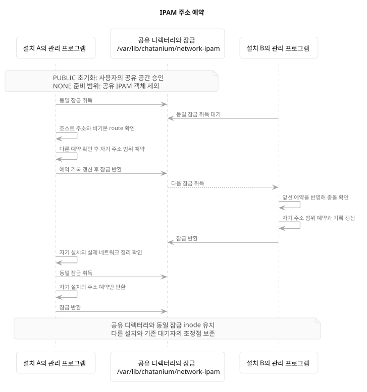

공유 잠금은 충돌 확인과 예약 기록을 한 번의 작업으로 묶는 데 사용해요.
두 설치가 동시에 여유 범위를 확인하면 같은 범위를 선택할 수 있으므로,
관리 프로그램은 호스트에서 한 설치씩 이 작업을 진행하도록 순서를 정해요.
잠금을 잡은 설치가 기존 주소와 예약을 확인한 다음 자기 범위를 예약해요.
예약을 기록하고 잠금을 풀면 다음 설치가 앞선 예약까지 반영해 주소를 골라요.

이 예약은 실제 네트워크를 사용하는 동안 유지해요.
설치를 purge할 때는 관리 프로그램이 해당 설치의 네트워크 정리를 먼저 확인해요.
남은 흐름과 소유 객체를 해소한 뒤 자기 설치의 주소 예약을 반환해요.
다른 설치가 쓰는 예약과 공용 조정 공간은 그대로 보존해요.
따라서 설치 하나의 제거 뒤에도 남은 설치가 같은 순서로 예약을 이어 가요.

공유 잠금 파일을 보존하는 이유는 파일 자체가 조정의 기준이기 때문이에요.
잠금 파일을 지웠다가 같은 경로에 다시 만들면,
기존 대기자는 예전 파일을 붙잡고 새 호출자는 새 파일을 열 수 있어요.
각 호출자가 서로 다른 파일에 잠금을 잡으면 주소 선택을 동시에 진행할 수 있어요.
설치 프로그램은 공유 디렉터리와 잠금 파일을 유지해 같은 파일로 순서를 맞춰요.

공유 파일의 보존 범위는 주소 조정에 필요한 인프라예요.
설치별 network namespace와 연결 객체는 앞서 설명한 정리 흐름으로 회수해요.
이처럼 예약을 실제 사용과 정리에 연결하는 원칙은 모듈 중지와 장애 복구에도 적용해요.

## 중지와 장애 복구

사용자가 중지를 요청하면 재시작 뒤에도 그 의도를 유지해야 해요.
`stop`은 살아 있는 owner에게 인증된 요청을 보내고,
owner는 먼저 원하는 실행 상태를 `STOPPED`로 영속 기록해요.
owner는 이미 보유한 `lease`로 정리를 진행하므로 요청자는 관리 채널로 종료를 맡겨요.
Ctrl+C도 같은 내부 drain으로 합류해 정리 순서를 공유해요.

owner는 새 실행을 닫고 진행 중인 작업의 drain을 시작해요.
그다음 실행 승인과 외부 통신을 철회하고 정확한 하위 서비스를 중지해요.
앞서 설명한 통신 종료 순서대로 pump와 연결 참조를 해소한 뒤,
임시 저장소는 연결과 실행 참조를 모두 해소한 뒤 회수하도록 예약을 유지해요.
정리에는 취소한 요청과 분리한 유한한 기한을 사용해요.

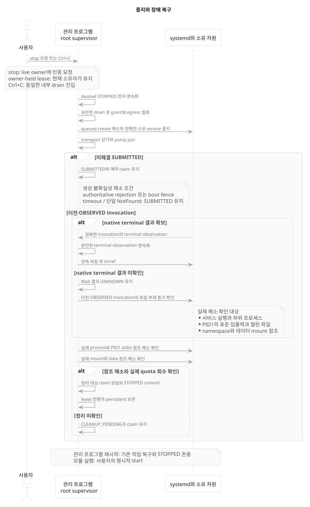

서비스 결과를 보존하는 순서도 공간 회수에 영향을 줘요.
관리 프로그램은 실제 종료 관측을 journal에 기록한 뒤 systemd 참조를 `Unref`해요.
그다음 PID1이 가진 stdio와 데이터 참조까지 해소했는지 확인하고,
quota 회수를 확인한 자원부터 예약을 완료해요.
게스트의 `EXIT`는 진단 정보로 보존하며, 호스트 서비스 관측으로 실행 결과를 판단해요.

생성 결과가 불확실하면 중지 작업도 그 불확실성을 이어서 다뤄요.
D-Bus timeout이나 한 번의 `NotFound` 뒤에는 `SUBMITTED`와 자원 예약을 유지해요.
관리 프로그램은 확정적인 거절 증거나 재부팅을 통한 이전 작업 차단을 확인해야
이 생성 예약을 해제할 수 있어요.
정리를 확인하는 동안에는 같은 instance 이름과 예약 자원을 보존해요.

이미 관측한 정확한 invocation은 실행 결과와 정리 결과를 각각 기록할 수 있어요.
종료 결과 확인이 남으면 실행 결과는 `UNKNOWN`으로 유지해요.
별도 증거로 해당 실행의 프로세스와 모든 데이터 참조의 해소를 입증하면,
관리 프로그램은 그 실행의 정리를 완료할 수 있어요.
정리 증거도 부족하면 `CLEANUP_PENDING`과 필요한 참조를 유지해요.

관리 프로그램을 재시작하면 기록한 이전 작업부터 복구해요.
원하는 상태가 `STOPPED`이면 복구를 진행하고 새 모듈 실행은 보류해요.
사용자의 명시적 start가 새 실행 의도를 기록해요.
이미 알고 있는 데이터의 유실이나 식별 불일치를 발견하면 복구 상태로 전환하고,
원래 기록을 보존해 조정에 사용해요.

## 서비스 운영과 데이터 제거

포그라운드 동작과 정리를 확인한 사용자는 상시 서비스 운영을 선택할 수 있어요.
`service install --enable --now`는 서비스 등록과 현재 실행을 함께 요청해요.
관리 프로그램은 유지보수 lease 아래에서 준비 상태와 소유권을 확인하고,
새 `RUNNING` 의도를 기록한 뒤 lease를 반환하고 서비스를 시작해요.
서비스는 포그라운드와 같은 승인 및 자원 제한을 사용해요.

서비스의 자동 재시작은 기록한 실행 의도를 따라요.
사용자가 stop으로 남긴 `STOPPED`는 복구 뒤에도 유지해요.
앱을 잠시 중지할 때는 보관 데이터를 남기고,
프로그램을 uninstall할 때는 중지와 정리를 확인한 뒤 자체 코드와 unit을 제거해요.
설치 식별과 복구 bundle을 포함한 보존 정보는 이후 복구와 데이터 제거에 사용해요.

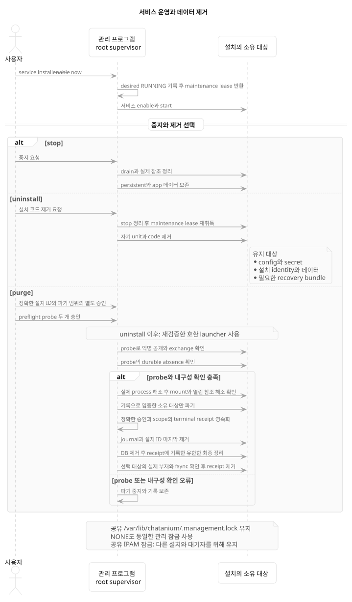

uninstall 뒤에도 설정과 비밀을 보존해 이후 정리에 사용해요.
관리 프로그램은 기존 계정과 원본 이미지를 보존하고,
보관 데이터와 복구에 필요한 bundle도 유지해요.
데이터를 지우는 purge에는 정확한 설치 ID와 삭제 범위에 대한 별도 승인이 필요해요.
사용자는 다시 검증한 호환 launcher로 보존 설치의 purge를 요청할 수 있어요.
이 launcher는 기존 기록을 읽어 정리하므로 설치를 새로 초기화하는 과정과 구분해요.

파기 시작 전에는 마지막 기록까지 안전하게 이어 쓸 수 있는지 확인해야 해요.
관리 프로그램은 승인한 두 preflight probe로 metadata 파일시스템을 검사해요.
익명 임시 파일의 공개와 파일 교환을 확인하고,
파일과 부모 디렉터리 동기화를 거쳐 probe의 제거까지 영속 확인해요.
필수 동작을 지원하는 환경에서 선택한 데이터의 첫 파기 작업을 시작해요.

관리 프로그램은 실제 프로세스 종료와 마운트 해제를 확인하고,
열린 데이터 참조까지 해소한 뒤 소유 기록으로 입증한 대상만 삭제해요.
앱 데이터도 writer와 quota 회수 확인을 거쳐 같은 흐름에서 처리해요.
정리에 필요한 helper를 사용한 뒤 제거하고,
journal과 설치 ID는 나머지 삭제를 끝낸 마지막 단계에 지워요.

journal을 지우기 전에 관리 프로그램이 남은 정리를 `terminal receipt`라는 확인서에 기록해요.
SQLite 제거 뒤에도 root가 이 확인서를 검증해 원래 승인 범위를 확인하고,
기록한 유한한 잔여 삭제만 재개해요.
DB 부재를 발견하면 정확한 확인서와 대상의 실제 부재 증거를 함께 대조해요.
선택한 대상의 물리적 부재와 동기화를 확인한 뒤 임시 확인서도 제거해요.

설치 제거 뒤에도 공유 조정에 사용하는 파일은 보존해요.
`/var/lib/chatanium/.management.lock`은 `NONE` 설치에도 적용하는 공용 관리 잠금이에요.
`PUBLIC`의 IPAM 공유 잠금도 앞서 설명한 수명에 따라 유지해요.
각 설치의 실제 자원 정리와 공유 잠금의 보존을 함께 지켜,
다른 설치와 대기 중인 관리 작업이 같은 파일을 계속 사용하도록 해요.

## 배포 갱신과 개발 흐름

사용자가 배포물을 갱신할 때도 승인한 모듈과 보관 데이터의 연결을 유지해야 해요.
정적 launcher는 native voice worker와 원본 `rungv`를 포함하고,
고정한 native helper 묶음을 함께 제공해요.
사용자는 릴리스 출처와 정확한 source commit을 별도로 검증하며,
설치 프로그램은 전체 bundle을 보호된 digest 디렉터리에 공개해요.

갱신은 실행을 drain하고 중지한 뒤 데이터 마운트를 해제한 상태에서 진행해요.
관리 프로그램은 새 bundle이 journal과 cache 형식을 다룰 수 있는지 확인하고,
보관 데이터의 hostfs metadata 세대도 함께 검토해요.
실행 또는 복구가 참조하는 세대와 백업을 보존해요.
바이너리 되돌리기는 실행 파일의 호환성을 확인하고,
데이터 되돌리기는 별도로 보관한 데이터와 형식 조건을 확인해요.

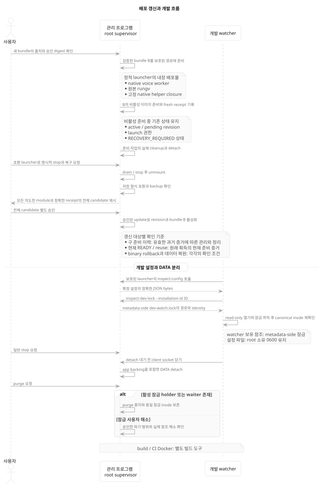

이전 이미지 준비 이력도 현재 기준으로 분류해요.
현재 실행과 재사용에는 원래 획득 시점의 준비 증거가 필요해요.
정확한 과거 완료 증거를 확인한 일부 이전 이력은 격리해 관리와 정리에 사용하고,
기록과 자원 예약을 보존해요.
새 실행 후보에는 현재 준비 기준을 충족한 이미지와 실제 완료 증거를 연결해요.

설치한 bundle이 현재 준비 방식을 지원하기 어려우면 새로 검증한 bundle로 이미지를 준비해요.
이 bundle은 비활성 상태에서 새 작업의 이미지와 준비 결과를 만들어요.
이 준비 단계에서는 기존 설치의 bundle과 revision을 그대로 유지해요.
기존 복구 상태와 실행 허가도 유지하므로 설치 전환은 별도 승인을 거쳐요.
실제 준비 정리와 detach를 마친 뒤 일반 복구를 요청하고,
별도로 승인한 전체 후보 update에서 새 bundle 활성화를 진행해요.

전체 후보 update는 기존에 운영하려던 모듈을 보존해요.
관리 프로그램은 사전 승인한 교체 대상과 준비 계획을,
새 bundle이 만든 정확한 image/cache 완료 증거에 대조해요.
일치하는 결과를 확정한 뒤 백업과 설정 교체를 진행해요.
이 구분으로 비활성 이미지 준비와 설치 전체 전환의 승인 시점을 분명히 해요.

개발 중에도 보호된 설정과 정상 중지 흐름을 함께 유지해요.
watcher는 설치 ID로 보호된 launcher의 `inspect-config`를 호출해 확정한 설정 bytes를 읽어요.
설정 파일은 root 소유의 제한된 접근 상태로 유지하고,
watcher는 설정 변경을 감지해 runtime 교체 직전에 다시 확인해요.
개발 worker에는 private 초기화 stream으로 설정을 전달해요.

watcher를 켠 상태에서도 일반 stop은 앱 backing을 detach해요.
이를 위해 watcher는 설치 metadata 쪽의 `Installation/dev-watch.lock`을 대기 중 유지해요.
watcher는 `inspect-dev-lock`이 제공한 정확한 파일 식별을 읽고,
기존 파일에 잠금을 잡은 뒤 실제 inode를 다시 대조해요.
클라이언트 socket은 detach 대기 전에 닫고,
활성 잠금 보유자나 대기자가 있으면 full purge를 보류해요.

빌드와 CI의 Docker 사용은 배포물 제작 흐름에 두고,
실제 운영 호출자는 이 자체 포함 실행 흐름으로 함께 전환해요.
제안서는 포그라운드에서 서비스 전환까지 이어지는 동작을 통합 완료 조건으로 정해요.
owner 사망 뒤 복구와 uninstall의 데이터 보존을 확인하고,
다시 확보한 launcher의 승인 purge까지 확인해 전체 운영 흐름을 마무리해요.
